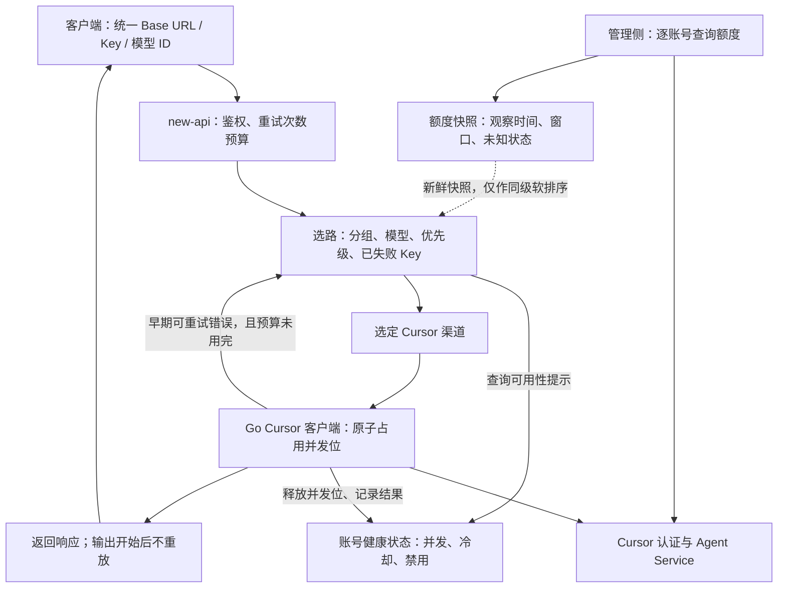
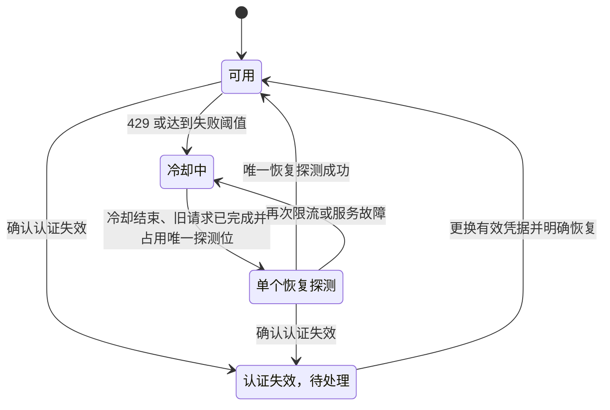

# Cursor 多账号池：本地实现与后续验收

本文随个人 fork 保存，`.local-tests/` 证据链接仅供原实验机器核对；真实凭据、数据库和原始压测数据不进入 Git。

**本地阶段已完成。** 当前采用“一账号一渠道”，额度和健康状态已经接入选路；重试按 Key 排除失败账号，冷却结束后由后续请求触发唯一探测并恢复。两组虚构账号经过真实 Go 分发、重试、Cursor 适配器及本地 HTTP/2 链路，覆盖三种数据库和内存缓存开关；已部署到本机 `3300`，详见 [本轮验收](../.local-tests/cursor-poc/pool-routing-20261015/summary.json) 与 [使用、架构及重跑命令](cursor-native-local-guide.md)。

当前仍只有一个真实账号。此前模拟账号池验收未新增凭据、未进行真实生成、未改按量付费设置；模拟账号只存在于独立测试进程。已有动态模型目录、effort / fast / context 参数、两窗口额度、按量状态及重置时间保留。真实 A/B 的身份、预算独立性和端到端切换，待第二个账号补齐后验收。

2026-10-15 单真实账号验证：Grok 前轮一波 8 并发完整成功；Composer 曾只有思考、无正文。后续原始协议诊断捕获上游完整结束却没有 `text_delta`，最终检查点也没有 text，排除了该样本的正文漏转；深层模型行为或请求兼容性原因仍未确定。当前以 `cursor_empty_response` 区分空响应与断流，不重放已经开始的流。部署后 Composer Standard / Fast、Grok Fast 的 2/4 并发共 18 次测量全部成功，仍不据此宣称根治。并发由 `CURSOR_MAX_IN_FLIGHT` 配置，测试后恢复默认 `2`；详见 [诊断与复验](cursor-native-local-guide.md#55-composer-无正文诊断与-fast-对照2026-10-15) 和 [速度配置建议](cursor-native-local-guide.md#56-速度优先时怎么配)。

## 1. 目标与判断依据

本地验收需要证明四件事：每个账号能够独立认证并查询额度；两个账号都能实际生成回答；一个账号不可用时新请求能够转给另一个；故障解除后能够有控制地恢复使用。

这些概念需要分别处理：

| 概念 | 对方案的影响 |
| --- | --- |
| Key 与账号 | 同一账号的两个 Key 不代表两份额度；需要确认账号身份和额度是否独立 |
| 账号与额度归属 | 不同用户也可能共享团队预算；不能直接把额度百分比相加 |
| 套餐额度与速率限制 | 套餐有剩余仍可能遇到并发或速率限制，必须分别记录 |
| 主备与均衡分流 | 主备主要提高可用性，平时由主账号承担请求；均衡分流才会主动利用多个账号 |
| 切换与重放 | 开始输出之前可以按策略尝试其他账号；已输出的流或已交付的工具调用不能透明重放 |

增加账号不会自然降低单次模型生成延迟。预期收益是减少某个账号繁忙或故障造成的失败，以及在上游允许的范围内分担并发。是否有吞吐收益，需要单独测量，不能从账号数推算。

## 2. 当前实现已有能力与缺口

下表以个人 fork 的 `codex/cursor-account-pool-admin` 分支代码为依据，不代表上游已正式接收 Cursor 渠道。

| 项目 | 已有事实 | 多账号仍需补齐的部分 |
| --- | --- | --- |
| 原生 Cursor | 类型 `64`，真实 `grok-4.7` 文本、流式和工具往返已通过 | 第二个独立账号及端到端验证 |
| 模型能力 | 按 Key 查询两份上游目录，保留共同可用变体；界面展示候选 Cursor 账号的公共参数组合，实际选中账号再校验 | 两个真实账号的权限差异与组合交集仍待验收；尚未按请求参数选择账号 |
| 多渠道选择 | 按分组/模型约束后读取健康提示，纯 Cursor 池同级参考额度并加权随机 | 已实现失败 Key 排除；不同 Key 是否同属一账号仍待归属映射 |
| 多 Key 渠道 | 宿主支持随机或轮询选 Key | Cursor 管理接口拒绝多 Key 渠道的额度和目录查询，继续采用一账号一渠道 |
| 单 Key 健康状态 | 并发上限、429 冷却、5xx 熔断、401 禁用、半开探测；并发冷却修复已通过回归并部署 | 选路已读取缓存健康提示并跳过不可用账号；真实双账号仍待验收 |
| 额度查询 | 可分别调用每个单 Key 渠道的余额接口 | Playground 分账号显示；已知 Vendor 映射额度池并参与软排序；无后台全账号刷新 |
| 重试 | 宿主统一决定是否重试，当前实验次数为 `1` | 会话、固定渠道、跨分组已回归；跨重试统一总时间预算未实现 |
| 管理与日志 | 请求 ID、渠道轨迹和策略事件；新增管理员账号池页面，按渠道显示额度、健康及操作入口 | 管理页于 2026-10-20 本地完成并部署 STAG；真实多账号仍待验收，日志轨迹继续复用现有界面 |

目录发现与预算必须分开：同一账号的 Cursor Models 与 Other Models 可以处于不同状态。现在依据已认证 Vendor、实际 429 和未过期的两窗口用量快照，只有“当前窗口耗尽、另一窗口未耗尽”才隔离冷却；其余 429 仍作用于整个 Key。此归因是本地启发式，不是上游明确提供的错误范围。真实 Other Models 冷却期间 Grok 与 Composer 已立即成功；规则及局限见 [本地文档 4.3](cursor-native-local-guide.md#43-并发熔断和重试)。

主要依据：[目录与能力](../pkg/cursor/models.go)、[目录缓存](../pkg/cursor/catalog.go)、[渠道选择](../service/channel_select.go)、[加权随机与优先级选择](../model/channel_cache.go)、[Key 轮询](../model/channel.go)、[额度接口](../controller/channel-billing.go)、[原生客户端](../pkg/cursor/client.go)、[重试决策](../service/relay_error.go)、[管理日志字段](../service/log_info_generate.go)。

### 必须提前处理的三个细节

**同优先级的失败重试已按 Key 排除。** 原有加权随机可能重复选中 A，`use_channel` 仅是日志轨迹。本版在请求策略状态中保存失败 Key 的 SHA-256（不写日志），再次选择时排除对应全部渠道，跨自动分组也保留；只在本次请求内有效。相同 Key 的配置不代表额外容量，建议避免重复配置。来源：[账号池策略](../service/cursor_routing.go)、[失败记录](../service/request_policy.go)。

**并发完成顺序提前解除冷却的问题已修复。** 修复前，同一 Key 的两个在途请求中，一个先返回 429，较旧请求稍后成功会清空刚建立的冷却；后续较短 429 或 5xx 也可能缩短 `Retry-After`。2026-10-15 用虚拟时钟及 HTTP/2 屏障测试复现后，已改为只允许唯一恢复探测解除冷却，后续错误只能延长冷却。探测必须等旧请求全部完成后才能开始，因此当前无需额外引入每请求状态代次。七个状态用例、一个 HTTP/2 集成用例和相关 race 检查通过，已部署。来源：[Client.acquire / finish](../pkg/cursor/client.go)、[回归用例](../pkg/cursor/client_test.go)、[本次验收证据](../.local-tests/cursor-poc/cooldown-fix-20261015/)。

**超时与流中断不能承诺自动切换。** 当前宿主将 `504`、`524` 列为始终不重试的状态；流已开始后的失败也不透明重放。固定渠道令牌和严格会话绑定会进一步禁止跨渠道重试。验收必须保留这些边界，不把所有错误统一当成“换账号再试”。来源：[状态码策略](../setting/operation_setting/status_code_ranges.go)、[重试决策](../service/relay_error.go)、[固定渠道鉴权](../middleware/auth.go)。

## 3. 方案选择

| 路径 | 优点 | 成本与限制 | 建议 |
| --- | --- | --- | --- |
| 一个渠道放多个 Key | 直接复用现有轮询，配置紧凑 | 当前无法逐 Key 查额度，自动账号池会排除此类配置 | 拆成单 Key 渠道 |
| 一个账号一个渠道，主备优先级 | 可分别查额度、禁用、看日志；现有选路即可使用 | 主账号承担正常流量；选路先检查冷却，原生调用再次原子准入 | 本地已实现，真实双账号待验收 |
| 一个账号一个渠道，健康状态参与均衡选路 | 可跳过不可用账号，支持同级分流与明确的重试排除 | 服务层过滤和原生状态提示已实现，实库与 HTTP/2 回归通过 | 模拟多账号已验收 |

推荐保留“一账号一渠道”作为管理方式。第一轮无需新增账号数据库表，也无需额外部署一个网关进程。未来若需要给同一账号管理多把 Key，再单独引入账号与凭据的关联，避免现在就维护两份渠道配置。

## 4. 后续真实双账号验收

### 4.1 待补凭据后的配置

以下为待执行配置，尚未应用到运行服务：

| 配置项 | 账号 A | 账号 B |
| --- | --- | --- |
| 渠道类型 | Cursor（64） | Cursor（64） |
| 模型 | `grok-4.7` | `grok-4.7` |
| 分组 | 相同的本地实验分组 | 与 A 相同 |
| 优先级 | 高于 B，例如 `10` | 例如 `0` |
| 凭据 | 当前账号的 User API Key | 第二个独立账号的 User API Key |
| 额度查询 | 按 A 的渠道 ID 查询 | 按 B 的渠道 ID 查询 |

保留客户端统一入口和模型名。验收用令牌不得固定到单个渠道，也不能启用禁止切换的严格会话规则。现有 `RetryTimes=1` 足以覆盖“首选 A、失败后尝试 B”的两次尝试；具体错误仍需满足宿主重试条件。

先分别验证 A、B 的认证、额度、动态目录和短请求，确认测试参数在两个账号的目录交集中，再测试组合路径。单独验证可以临时限定测试范围；自动切换验收则必须使用未固定渠道的真实入口，不能通过脚本手动改账号冒充自动切换。

### 4.2 故障验证方式

采用两层证据，分别标明真实性：

- **真实账号检查**：两个独立账号分别查询额度、执行最小文本请求，并核对请求实际落到哪个渠道。
- **受控故障检查**：在隔离的本地测试进程中，用测试专用传输层对指定账号注入 429、503 或连接中断；其他请求仍可走真实账号。这样能够验证实际 Go 适配器和 new-api 重试链路，不需要故意耗尽上游额度。

测试注入能力只存在于测试构建或进程内测试夹具，不增加普通客户端可调用的故障接口，不关闭 TLS 验证，也不把真实凭据发往不可信代理。运行中的 `3300` Demo 与故障实验隔离；测试结束关闭测试进程，并恢复临时配置。

HTTP 429、Connect 协议内的 `resource_exhausted`、传输失败和流中途断开需要分别覆盖。报告必须写明“上游真实产生”或“本地注入”，不能把注入 429 写成实际触发了 Cursor 的速率限制。

## 5. 当前账号池的内部实现

本节的健康选路、额度软排序和失败排除已经完成本地实现及模拟验证。2026-10-20 已新增管理员按渠道查看的账号池页面、概览入口与网关额度设置入口，当前仅本地部署，见 [本地账号池管理](cursor-native-local-guide.md#10-本地-cursor-账号池管理2026-10-20)。渠道数量不代表已确认的独立账号数。职责仍分在 new-api 内部，复用渠道、用户和计费系统。

**图 1：当前账号池职责。** 宿主负责选择与重试，原生客户端负责认证、协议和原子并发控制；额度观察与实时健康状态分开维护。

### 5.1 选择与重试

先按授权分组、配置模型、请求约束和启用状态得到候选，再排除本请求已失败的 Key、账号级或目标模型额度池冷却、并发/探测位占用和认证禁用。纯 Cursor 候选中先保留最高可用优先级，再参考额度并沿用加权随机；同级账号排除完后才下探备用级。混合其他供应商时仅过滤 Cursor 健康和失败状态，保留宿主按重试次数推进优先级的语义。

健康状态读取只作为选路提示，不能代替并发锁。两个请求可能同时看到一个空闲位置，最终仍由原生客户端原子占用并发位；占用失败时宿主在剩余预算内尝试其他账号。

同一次请求只设置一层重试预算，不在宿主与适配器分别展开多轮重试。除了尝试次数，还需要整个请求的截止时间。现有原生调用的 90 秒是单次预算，不能直接作为含多次切换的总耗时上限。

[服务层策略](../service/cursor_routing.go) 通过通用候选回调接入缓存及数据库路径，数据库模型层不依赖 Cursor 协议包。选路只读内存，不在候选扫描时查询上游；映射后的模型在账号动态目录中确定额度池，未知 Vendor 保守处理。账号映射不明确时，先按已确认的账号配置工作；同一 Key 的重复配置应合并健康状态，多个不同 Key 是否属于同一账号仍需确认。

### 5.2 健康状态与恢复

**图 2：账号恢复状态。** 单 Key 的账号级状态与两个额度窗口分别采用冷却/唯一探测；认证失效始终作用于整个 Key。旧请求晚到的成功不能解除冷却，后续错误不能缩短既有冷却。取消探测释放位置后仍保持待探测状态。选路已经读取上述状态。按真实账号统一多把不同 Key、管理员显式恢复和多实例共享状态仍是后续工作。恢复由后续流量触发，没有后台探测器。

当前沿用每 Key 最多 2 个在途请求、429 至少冷却 30 秒、累计两次 5xx 后冷却的默认值，但它们是本地保护参数，不是已确认的 Cursor 官方限额。实际参数需要通过观察校准。

| 情况 | 当前处置与边界 |
| --- | --- |
| 本地并发位满 | 尝试其他账号，不累计上游故障，不永久禁用 |
| 上游限流 | 尊重有效 `Retry-After`；无明确时间时有限冷却，避免密集探测 |
| 服务端临时错误 | 计数并在阈值后冷却；恢复只允许一个探测请求 |
| 明确凭据失效 | 禁用对应凭据并提示管理员；同时检查 new-api 持久化禁用状态 |
| 模型无权限或 403 | 原生模型校验/上游错误返回；不设独立的永久模型禁用表，不据此全 Key 禁用 |
| 参数错误或协议版本失配 | 作为请求/实现问题处理，避免对所有账号轮流发送同一坏请求 |
| 504、524 或输出后的错误 | 沿用明确的不重放边界；若以后调整超时重试，需要单独定义是否可能重复执行 |
| 客户端取消 | 释放连接与并发位，不惩罚账号 |

单实例阶段使用内存状态即可。多实例部署时，各进程的单账号并发上限（默认 2，可配置）会叠加，届时必须引入共享并发租约和带过期时间的故障状态；当前本地方案不声称支持分布式全局限流。

### 5.3 额度展示与使用策略

已实现 Playground 的只读额度卡片：分别显示 Cursor Models / Other Models 的已用百分比、耗尽提示、采集时间、当前模型窗口，以及账号或窗口冷却。普通用户通过自己的分组与配置模型读取候选状态；相同 Key 去重，多 Key 分开呈现，仅使用候选顺序号，不泄露真实渠道/账号标识。

Playground 每 10 秒取状态，生成结束或手动刷新也会读取；上游额度按 Key 缓存 30 秒，合并并发读取，失败退避 10 秒，单次上限 20 秒。失败/过期显示未知，不把旧值作为健康证据，也不将缺失值补零。新增管理员页面通过 `GET /api/channel/:id/cursor/status` 逐渠道读取，页面活跃时每 30 秒刷新，支持停用渠道的只读检查；采用管理员认证及 `channel.read` 权限，原始凭据不进入响应。真实跨账号管理验收仍待第二个账号。

100% 仅表示套餐窗口用尽。已并行查询按量付费设置：当前真实账号已启用，但成员支出达上限，团队仍有余额。不会单凭百分比禁止请求、连续调整权重或把多个百分比求和。只有目标池套餐 ≥100%、付费预算明确关闭/耗尽且快照新鲜时，才在纯 Cursor 同优先级候选中降为次选；全部候选都如此仍允许尝试。未知/过期数据、仍有按量预算和待恢复探测不会因此降级。收到实际 429 后才结合快照判断是否启用窗口冷却；两窗口都满、证据不足或已知额外付费预算仍充足时，仍按账号冷却。模型目录提供的 Vendor 只对当前已核对的供应商作窗口映射，未知 Vendor 不根据名称猜测。

重置时间来自上游 `billingCycleEnd`，不推算周期；缺失、无效或已过去时显示未知，等待上游刷新。当前真实账号报告为 2026-10-31 00:06:35（Asia/Shanghai）。每个池的最后完成请求结果作为历史事实显示，不能将“预算有余额”直接转为“账号可用”。按量接口失败保留套餐数据，未提供的字段不补零，也不解释为无限额。当前仅核对 legacy 双池与按量字段，不能据此声称完整支持新订阅的预付信用额度。实现和验收见 [本轮记录](../.local-tests/cursor-poc/ondemand-reset-20261015/summary.json)。

若要求“绝不发生套餐外费用”，还需独立的费用策略与执行机制。只读查询上游设置和 new-api 本地倍率为零都无法作出这一保证；本次没有开启付费或调整上限。来源：[Quota 实现](../pkg/cursor/quota.go)、[健康状态](../pkg/cursor/health.go)、[官方额外用量说明](https://prod.cursor.com/help/account-and-billing/overages)。

## 6. 验收矩阵与证据

最新结果见 [账号池矩阵](../.local-tests/cursor-poc/pool-routing-20261015/affinity-matrix-tests.log)：SQLite 3.50.4、MySQL 8.4.11、PostgreSQL 16.15 各自在内存缓存开/关下通过。包括额度软排序、模型映射、同 Key 别名排除、严格/优先会话、全池无可用账号、唯一恢复探测及 Grok/Composer 隔离。另有 [跨分组与混合供应商回归](../.local-tests/cursor-poc/pool-routing-20261015/cross-group-tests.log)。以下保留此前功能的验收依据，并区分模拟与真实账号行为。假凭据只用于测试，不代表第二个真实账号。原生客户端用例位于 [client_test.go](../pkg/cursor/client_test.go)，执行结果见 [race 检查](../.local-tests/cursor-poc/cooldown-fix-20261015/race-tests.log)。九个网关用例位于 [channel_pin_retry_test.go](../controller/channel_pin_retry_test.go)，通过已授权请求上下文执行真正的分发、重试、原生适配器与 HTTP/2 客户端，使用独立 SQLite 和本地 TLS 假上游，结果见 [网关集成记录](../.local-tests/cursor-poc/cooldown-fix-20261015/native-routing-tests.log)。实际账号记录见 [真实推理](../.local-tests/cursor-poc/model-options-20261015/live.json) 与 [额度查询](../.local-tests/cursor-poc/model-options-20261015/usage.json)。

| 场景 | 验收判据 | 当前证据与未完成部分 |
| --- | --- | --- |
| 账号独立性 | A、B 账号及预算归属已确认；不能仅靠 Key 哈希判定 | 待第二个真实账号及归属确认 |
| 同账号窗口隔离 | Other Models 冷却不阻断仍有额度的 Cursor Models | 真实 Claude 429 后 Grok / Composer 立即成功；重复 Claude 本地拒绝，见 [live.json](../.local-tests/cursor-poc/quota-scopes-20261015/live.json) |
| 分别查询额度 | A、B 都返回带时间戳的快照，错误和未知值明确 | A 真实查询通过；缓存按 Key 隔离、缺失值不补零的夹具检查通过；B 待补 |
| 分别推理 | A、B 都通过短文本测试，渠道 ID 可追溯 | A 的三组可选参数和四次文本/流式/工具请求通过；B 待补 |
| 主账号 429 | 同一客户端请求先尝试 A，再由 B 返回成功；A 进入冷却 | HTTP 429 与 Connect 限流均通过原生跨渠道集成检查；后续请求不再向 A 发 Run |
| 主账号连续 5xx | 达到阈值后停止放行 A，B 仍可用 | 三次网关请求实际只向 A 发两次 Run，均由 B 成功响应；连接中断切换也通过 |
| 并发限制 | 默认 A 有两个在途请求时拒绝第三个；其他账号仍可用 | 默认保护、配置为 2/4/8 的 HTTP/2 准入、跨池总上限和独立状态检查通过 |
| 交错完成 | 旧成功不清除新冷却，短错误不缩短已有冷却 | 修复前失败、修复后通过；包含真实 HTTP/2 连接上的可控交错 |
| 半开恢复 | 冷却时无新 Run，之后只允许单探测；成功恢复、失败续冷却、取消可再探测 | 七个状态用例及 HTTP/2 集成通过 |
| 认证隔离 | 凭据失效不泄露 token，不污染其他 Key 的认证缓存 | 401 禁用后 B 仍连续成功；认证错误脱敏及缓存隔离检查通过；真实双账号待补 |
| 全部不可用 | 按次数预算结束，无循环重试；总时间另有明确边界 | 集成检查断言仅尝试 A、B 各一次，并记录 `attempt_budget_exhausted`；跨重试统一总时间预算尚未实现 |
| 流中途失败 | 收到错误并停止，不重放已开始的流 | 完整原生调用链返回 `incomplete_stream`，B 的 Run 次数为零 |
| 固定渠道与超时 | 不违反禁止跨渠道重试的约束 | 固定渠道遇到 429 不切换；504 不重试，两项集成检查通过 |
| 取消与工具 | 取消释放连接与并发位，工具结果匹配 | 连接取消、探测取消用例及真实工具往返通过 |
| 清理与恢复 | 测试进程退出，配置保持，真实账号可用 | 冷却修复前后配置一致；参数功能随后按需更新模型范围及展示；仅 new-api 容器运行，真实复验通过 |

日志优先复用 `request_id`、`admin_info.use_channel` 和 `admin_info.request_policy`。新增证据只记录账号别名、渠道、错误分类、冷却时间与尝试结果，不记录 Key、访问令牌或原始敏感响应。真实调用次数和注入事件次数分开统计。

受控测试应覆盖原生适配器到宿主重试的完整调用链。仅在脚本里执行“失败就换 Key”不能证明 new-api 自动切换；仅有 HTTP 200 也不能证明流正常结束。

## 7. 实施范围与确认事项

本地阶段在本次完成；后续事项不设未经确认的排期：

1. **已完成**：原生接入、动态模型与参数、Playground 额度/按量/重置状态，以及健康与额度参与选路、失败 Key 排除、模拟多账号自动切换和恢复；文档与本机部署已同步。
2. **待真实凭据**：补第二个独立账号后分别验证额度、目录交集与最小推理，再验收真实 A/B 切换。未知归属的不同 Key 不自动视为独立账号容量。
3. **性能验证后新增待办**：Composer 已确认存在上游无正文响应，后续如继续诊断，应对照相同账号和提示的官方客户端，区分模型服务异常与请求构造兼容性。Fast 的 2/4 并发短测已完成；持续负载、长上下文和工具压力仍未覆盖，Grok 8 并发单波成功不代表持续容量。空响应仍按账号级 5xx 策略保护，是否进一步细分模型健康需要独立评估。
4. **超出本地阶段**：多实例共享并发/熔断状态、不同 Key 的真实账号归属和共享团队预算、统一跨重试总时间预算、生产负载和费用硬限制。按后续需要再确定范围。

需和账号提供方确认的事项：

| 待确认 | 建议的初始取值或处理 |
| --- | --- |
| 账号和预算是否独立，是否共享团队费用 | 确认后再定义池容量，不直接累加百分比 |
| 主要目标是主备可用性还是同时分流 | 本地已支持同级加权随机；真实流量策略待账号归属确认 |
| 是否允许套餐外费用、测试调用预算 | 明确费用上限；暂不假设允许按量消费 |
| 是否都具备同一 `grok-4.7` 参数组合的访问权限 | 两个账号分别验证；能力不同则分池或限制模型 |
| 第二个账号凭据的交付方式 | 本机私密文件路径和变量名，聊天只传引用，不传 Key |

凭据处理继续沿用服务器端鉴权、TLS 验证、权限隔离和敏感信息不入日志的约束；本次审阅参考 [OWASP ASVS 5.0.0](https://owasp.org/www-project-application-security-verification-standard/)、[Authentication Cheat Sheet](https://cheatsheetseries.owasp.org/cheatsheets/Authentication_Cheat_Sheet.html) 与 [Session Management Cheat Sheet](https://cheatsheetseries.owasp.org/cheatsheets/Session_Management_Cheat_Sheet.html)。这只是适用控制的设计依据，不是完整合规认证。

本方案面向本地验证，不包含外部发布或上游提案。上游对逆向渠道和第三方包装的贡献限制仍见 [ISSUE.md](../.agents/github/ISSUE.md) 与 [PR.md](../.agents/github/PR.md)；通用改进是否能独立贡献需要另行评估。
