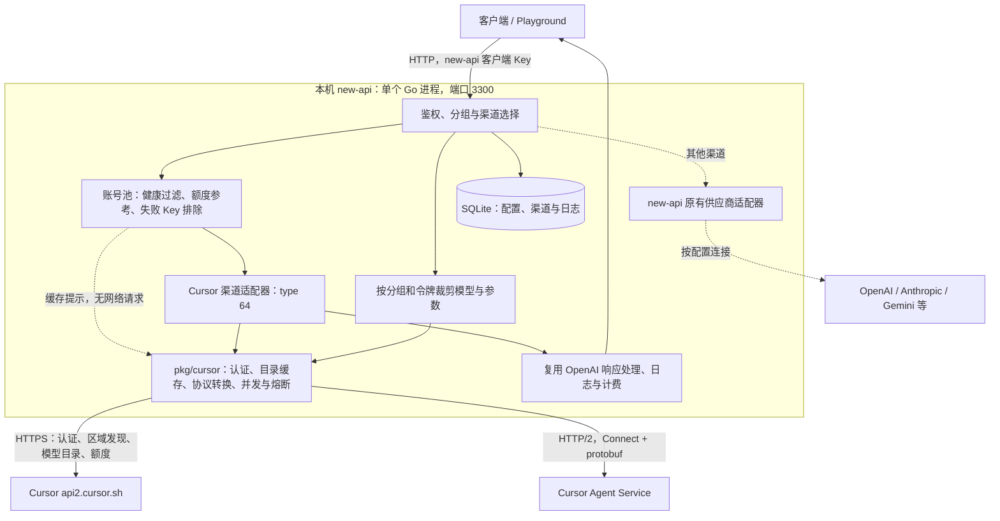
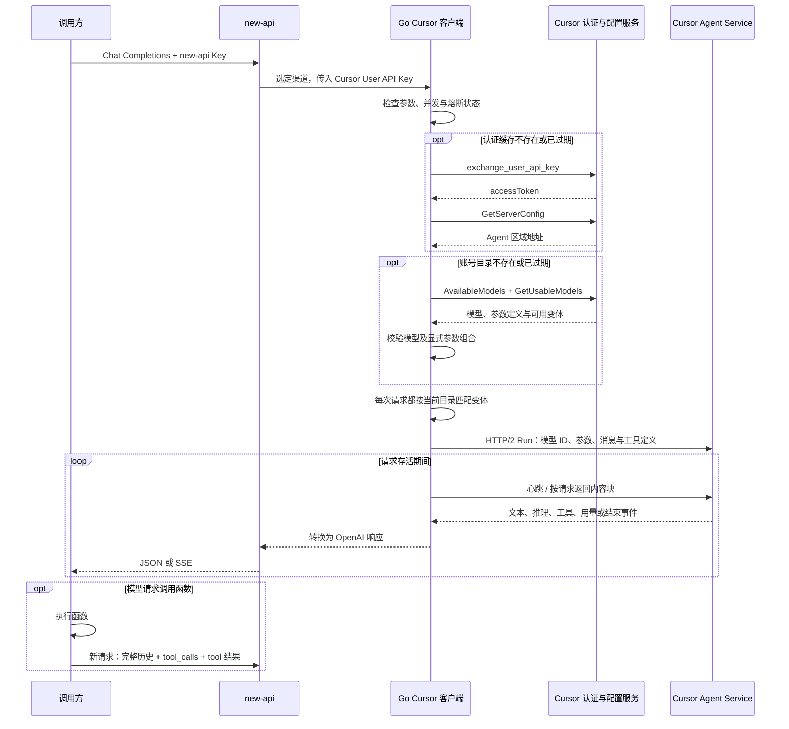

# new-api 原生 Cursor 本地网关：使用与架构

本文是用于个人 fork 的脱敏版说明。源码、协议测试夹具与汇总结果可提交；凭据、数据库、二进制、原始协议帧、截图及逐请求压测数据只保留在被 Git 忽略的 `.local-tests/`。文中的 `.local-tests/` 链接仅对原实验机器有效，GitHub 上不会包含对应文件；新 clone 不带这些私有实验资产。

**2026-10-20 账号池管理页已部署 STAG**：线上入口为 [Cursor 账号池](https://stag-dot-new-api-dot-bkai-develop.bkapps-gz1.woa.com/cursor-accounts)，包含账号状态、渠道操作及网关额度设置入口。独立本地验收实例为 `http://localhost:3330/cursor-accounts`；本地使用见第 10 节，提交、镜像和部署验收见第 11 节。后文 `3300` 是此前保留的 Demo。

本地 Demo 已接入 **按 Cursor 账号自动获取的模型目录**。客户端统一访问 new-api，Go Cursor 渠道在进程内完成认证、目录查询和推理；旧 Node 适配器已停止。当前账号的目录快照包含 **40 个基础模型、289 个含预设变体的模型 ID**，覆盖 7 个上游 Provider；这些数字是 2026-10-15 的观察值，不是代码中的白名单。

**Playground 默认只显示当前模型的额度池、已使用比例与可用状态；点击「详情」再查看两组套餐额度、按量付费开关、成员/团队支出上限、重置时间和最近请求结果。** 当前真实账号按量付费已启用，但成员上限已达；团队仍有余额不能覆盖成员限制。测试中已验证上游报告的套餐重置时间可以展示，界面按浏览器时区显示到分钟；真实账期时间不公开。 本机 `3300` 的真实账号验证通过：Other Models 已用 100%，Claude 触发 429 后进入该窗口的冷却，Grok 和 Composer 立即成功；当时重复 Claude 请求在约 25 ms 内被原生客户端拒绝；本版会在选路阶段跳过冷却账号。目录表示可选择的模型与配置，不承诺即时额度或容量。多真实账号和生产负载仍未验证。

**账号池选路也已完成本地验收并部署**：按模型额度池避开冷却账号、重试排除失败 Key，并在冷却结束后以单请求探测恢复。同优先级内参考新鲜额度和按量预算；未知数据允许尝试。两组虚构账号通过真实分发、重试、原生 HTTP/2 调用链，在 SQLite / MySQL / PostgreSQL 与内存缓存开关组合中验证，详见 [账号池验收](../.local-tests/cursor-poc/pool-routing-20261015/summary.json)。本地阶段完成；真实多账号、共享团队预算归属及生产负载仍待后续验证。

**最新诊断与性能验证**：已捕获 Composer 上游完整结束但无正文的样本；正常正文离线回放逐字一致，未发现已返回正文漏转。当前用 `cursor_empty_response` 区分正常结束的空响应与断流。部署后 Composer Standard / Fast、Grok Fast 的 2/4 并发共 18 次正文测量全部成功，但间歇性上游行为的深层原因仍未知。默认并发已恢复 `2`；原始诊断、消耗及配置建议见 5.5–5.6，前轮 2/4/8 结果保留在 5.4。

上一阶段证据见 [按量状态与重置验收](../.local-tests/cursor-poc/ondemand-reset-20261015/summary.json)、[真实调用](../.local-tests/cursor-poc/ondemand-reset-20261015/live.json)、[界面](../.local-tests/cursor-poc/ondemand-reset-20261015/playground-billing.jpg)。上一轮证据见 [额度与隔离验收](../.local-tests/cursor-poc/quota-scopes-20261015/summary.json)、[真实调用](../.local-tests/cursor-poc/quota-scopes-20261015/live.json)、[冷却界面](../.local-tests/cursor-poc/quota-scopes-20261015/quota-cooling.jpg)。上一阶段证据见 [动态目录验收](../.local-tests/cursor-poc/dynamic-catalog-20261015/summary.json)、[目录快照](../.local-tests/cursor-poc/dynamic-catalog-20261015/catalog.json)、[真实调用与边界](../.local-tests/cursor-poc/dynamic-catalog-20261015/live.json)、[Grok 流式与工具](../.local-tests/cursor-poc/dynamic-catalog-20261015/grok-text-tools.json)。此前的 [静态参数阶段](../.local-tests/cursor-poc/model-options-20261015/summary.json) 和 [并发冷却修复](../.local-tests/cursor-poc/cooldown-fix-20261015/) 作为历史记录保留，不代表当前配置。
本文对应本机分支 `codex/local-llm-gateway-demo`，基于提交 `7de10f2c602b50122017556e8a09cb7c488c273c` 的本地改动。下文“原生 Cursor”指本分支新增的实现，不代表上游 new-api 已正式支持 Cursor。

## 1. 现在能用什么

| 项目 | 当前状态 | 边界 |
| --- | --- | --- |
| 网页 Playground | Composer 真实流式回答通过 | 模型选择保留上游 Provider / ID；参数随模型目录变化 |
| OpenAI Chat Completions | 非流式、SSE 流式均已通过 | 路径为 `/v1/chat/completions`，文本输入 |
| 函数工具调用 | 工具请求和结果回传均已通过 | 工具由调用方执行，只支持自动选择 |
| Cursor 额度 | 原生查询与 Playground 两窗口展示通过 | 展示套餐百分比、按量设置和限额、重置时间；缺失值为未知，不能当作现金余额 |
| 账号池 | 额度/健康参与选路，失败 Key 排除、自动切换和恢复已通过模拟多账号验收 | 一账号一渠道，进程内状态；目前只有一个真实账号 |
| 并发与熔断 | 支持在有额度证据时隔离窗口冷却，真实 Other Models 429 不阻断 Grok / Composer | 全账号并发上限、认证失败和范围不明的故障仍统一保护；状态保存在单进程内存中 |
| 动态目录与参数 | 40 个基础模型、289 个模型 ID；自动获取 effort / fast / context 及其他上游选项 | 仅显示当前目录中有效的组合；额度和即时容量另行判断 |
| 其他供应商 | Cursor 目录中可见 Anthropic、OpenAI、Google 等 Provider；保留 new-api 原有直连渠道 | Cursor 内的模型不需要额外配置直连 Key；本轮受 Other Models 额度限制，未完成这些系列的生成验收 |
| 图像、音频、Responses API | 本 Demo 未实现 | 动态目录不会自动扩展协议能力；仍限定文本及函数工具 |

## 2. 打开并使用

### 2.1 地址与凭据

| 用途 | 本机配置 |
| --- | --- |
| 网页入口 | [http://127.0.0.1:3300/](http://127.0.0.1:3300/) |
| Playground | [http://127.0.0.1:3300/playground](http://127.0.0.1:3300/playground) |
| 客户端 Base URL | `http://127.0.0.1:3300/v1` |
| 客户端 API Key | 本地 `credentials.json` 的 `client_key` |
| 模型名称 / Provider | 来自上游 `name` / `legacySlug` 与 `vendorName`，例如 `composer-2.5` / `cursor`、`claude-opus-5-5` / `anthropic` |
| 管理员登录 | 同一文件的 `username` 和 `password` |
| 当前渠道 | `cursor-account-1`，ID 为 `1`，类型为 `Cursor`（`64`） |

凭据文件位于 `.local-tests/cursor-poc/credentials.json`。在本机编辑器中读取所需字段，不将文件、值或带凭据的截图提交到 Git。客户端使用 new-api 签发的 `client_key`；Cursor User API Key 由管理员配置在渠道中。

源凭据由账号持有人通过本机私有环境文件提供；文件位置与内容不公开。日常调用使用 new-api 签发的客户端 Key，无需重新读取源凭据。

在 Playground 中选择模型后点击参数按钮，选项来自该模型的实时目录。当前仍有 Cursor Models 额度，可选 `cursor / composer-2.5` 做短文本试用：它只有 Fast 开关，200,000 tokens 是固定窗口说明，不会虚构 effort 或 context 选项。`anthropic / claude-opus-5-5` 则展示推理强度、Fast 和上下文配置；目录可见不代表当前 Other Models 预算可用。

页面自动省略 Cursor 渠道不支持的 `temperature` 等通用生成参数；不支持的组合不可选择。切换模型会采用该模型的上游默认配置，当前模型的手动选项保存在浏览器中。Playground 页面活跃时每 5 分钟重取目录，重新打开页面也会获取；后端缓存过期后按需刷新，空闲时不会单独轮询。旧版本保存的 `cursor_effort / cursor_fast / cursor_context` 已替换为 `cursor_parameters`，升级后的首次使用应检查参数。

Provider 与模型 ID 是两个字段：API 只传 `model: "composer-2.5"`，不要传显示标签 `cursor / composer-2.5`。
### 2.2 查看、恢复和停止服务

前置条件：Docker 已启动，本机已有实验目录、镜像、二进制和数据库。以下命令均从仓库根目录执行：

```sh
cd /path/to/new-api
LAB="$PWD/.local-tests/cursor-poc"
python3 "$LAB/lab.py" status
```

若服务已停止，按当前原生配置恢复；这条命令不会执行实验初始化：

```sh
docker compose -f "$LAB/compose.yaml" -f "$LAB/compose.native.yaml" up -d --no-deps new-api
```

预期只有 `new-api` 服务运行，端口为 `127.0.0.1:3300 -> 3000`。容器采用 `restart: no`，Docker 重启后需要手动恢复。停止实验并保留绑定目录中的 SQLite 数据：

```sh
python3 "$LAB/lab.py" stop
```

`lab.py start` 会额外运行 `probe.py init`，重设实验的模型计价、重试、自动禁用配置、主渠道和客户端令牌模型范围。已开始自行调整配置后，日常恢复使用上面的 `docker compose ... up`。

`.local-tests/cursor-poc/` 是被 Git 忽略的本机实验资产，包含凭据、数据库、构建结果和辅助脚本。本文操作适用于这台已准备好的机器；新 clone 的仓库不会自动具有这些文件，当前尚未整理跨机器的一键安装包。

### 2.3 发起一次 API 请求

下面的 Python 示例从本地文件读取客户端 Key，不把 Key 写进命令行或输出。执行会产生一次真实 Cursor 模型调用并消耗其额度。

```sh
python3 - <<'PY'
import json
from pathlib import Path
import urllib.request

credentials = json.loads(
    Path('.local-tests/cursor-poc/credentials.json').read_text()
)
body = {
    'model': 'grok-4.7',
    'reasoning_effort': 'low',
    'cursor': {'fast': False, 'context': '256k'},
    'messages': [{'role': 'user', 'content': '计算 17 + 25，只返回数字。'}],
    'stream': False,
}
request = urllib.request.Request(
    'http://127.0.0.1:3300/v1/chat/completions',
    data=json.dumps(body).encode(),
    headers={
        'Authorization': 'Bearer ' + credentials['client_key'],
        'Content-Type': 'application/json',
    },
)
opener = urllib.request.build_opener(urllib.request.ProxyHandler({}))
with opener.open(request, timeout=110) as response:
    result = json.load(response)
print(result['choices'][0]['message']['content'])
PY
```

预期输出包含 `42`。需要流式输出时，将 JSON 中 `stream` 改为 `true`，客户端按 SSE（Server-Sent Events，即服务器逐条发送事件）读取 `data:` 行；可加 `stream_options: {"include_usage": true}`。客户端应检查事件中的 `error`，不能仅凭 HTTP 200 或 `[DONE]` 判断成功。

接入其他应用时，选择支持 OpenAI **Chat Completions** 的连接方式，填写上表三项：Base URL、`client_key`、`grok-4.7`。如果应用强制发送 `max_tokens`、`temperature` 或只使用 `/v1/responses`，当前 Cursor 渠道不能直接兼容，需要调整应用的请求配置。

### 2.4 工具调用

请求携带标准 `tools` 数组，元素使用 `type: "function"`，并提供 `name`、`description`、`parameters`。`tool_choice` 省略或设为 `"auto"`。

1. 客户端提交消息与工具定义。
2. 模型返回 `assistant.tool_calls`，流式情况下客户端先合并各段参数。
3. 客户端执行对应函数，追加完整的 assistant 消息及 `role: "tool"` 的结果消息；结果的 `tool_call_id` 必须匹配。
4. 客户端连同原历史和工具定义发起下一次 Chat Completions，得到最终回答。

网关只转译调用和结果，不在服务器上执行函数、Shell 或文件操作。工具结果缺少匹配调用 ID 会被拒绝。已有真实验收通过随机校验码确认模型读取了工具返回值，见 [实时调用记录](../.local-tests/cursor-poc/live-results.json)。

### 2.5 查询额度与添加账号

选择 Cursor 渠道模型后，输入框上方默认显示一行摘要：当前模型所属额度池、已使用比例和状态。额度池随模型切换，当前目录中的 Grok / Composer 属于 Cursor Models，Claude / GPT / Gemini 等属于 Other Models。多个候选账号各占一行，保留各自用量和状态，不合并百分比。

点击右侧「详情」展开两组套餐用量、按量预算、成员/团队支出限制、重置时间和历史请求等信息；「收起详情」恢复摘要。详情区最多占视口高度的 36%，上限 18rem，超出后内部滚动。详情按钮支持 Enter / Space，详情区可获得键盘焦点并滚动；新打开页面默认折叠，自动刷新不改变展开状态。

摘要优先提示账号认证失败、当前额度池或账号级冷却、并发占满；其他额度池的冷却只在详情中显示。套餐用完时，按量预算明确有余额显示「套餐已耗尽，按量预算有余额」，预算已耗尽或按量关闭显示「上游报告预算已耗尽」，缺少依据则明确显示可用性未知。套餐尚有额度时可显示「套餐额度可用」或最近请求结果，这些都不是下一次调用必然成功的承诺。过期、缺失或查询失败不沿用旧百分比，也不把旧成功记录显示为当前健康。

展开后的字段含义：

- `已使用` 是已消耗比例；详情中达到 100% 显示红色“套餐额度已用尽”。这不等于所有请求必然失败，也不自动禁止发送。
- `按量付费` 表示上游设置：已启用、已关闭或未知；“已启用”仍可能同时显示“支出已达上限”。成员和团队的已使用、上限及剩余按 USD 分别列出，任一已知限额耗尽都会提示。团队余额不会替代成员余额。
- `套餐额度重置时间` 采用上游 `billingCycleEnd`，显示浏览器时区，不自行按月推算。缺失、无效或已过期时为未知；已过期另提示等待上游刷新，不自动恢复额度或解除冷却。
- `该额度池最近一次请求成功/失败` 是本进程观测的历史结果，附状态码和时间，不能保证下一次请求成功；没有记录显示“实际可用性未知”。记录按额度池分开，切换池不会借用另一池的成功记录。认证失败仍单独提示；重启清空这些内存记录。
- `冷却至` 表示该范围暂不发新 Run；到期显示“等待恢复探测”，下一次该窗口请求才进行探测，页面不会自动发生成请求。
- `整个 Cursor 账号` 表示账号级保护，影响两组模型。单个窗口的额度冷却不会禁用另一窗口的发送按钮。
- 额度失败、过期或缺失显示不可用/未知，不用旧值显示为健康，也不补成 0%。多个候选 Key 分开列出，不求和或平均。

页面无论展开或收起，每 10 秒读一次状态；生成结束和右侧刷新图标（“刷新状态”）也会读取。后端同 Key 的额度快照缓存 30 秒；刷新按钮复用未过期快照，不强制高频请求 Cursor。健康状态来自内存，随状态请求即时读取。

登录用户的接口是 `GET /api/user/models?group=default&cursor_status_model=grok-4.7`。它只查询用户可用分组内、配置了该模型的启用 Cursor 渠道；相同 Key 去重，最多四路并发查询。返回 `quota`、`health` 和仅用于展示的候选顺序号 `route`，不返回 Key 或真实渠道/账号标识。未授权分组或未配置模型返回空列表；推理 Key 不能代替控制台登录凭据。

查询当前渠道 ID `1` 的套餐用量，不产生模型生成：

```sh
python3 "$LAB/lab.py" usage
```

也可在管理界面的渠道行操作中选择“查询余额”，再点击“更新余额”，查看返回的 JSON。底层接口是 `GET /api/channel/update_balance/1`，要求管理员身份；客户端推理 Key 不用于此管理操作。

返回值中的 `windows[].used_percent` 表示 **已使用百分比**；窗口名称为 `Cursor Models`、`Other Models`、`Total`。`observed_at` 是观察时间，`expires_at` 是本地快照过期时间，`billing_cycle_end_ms` 是上游返回的周期结束时间。`monetary_balance: null` 表示没有现金余额数据。缺失或异常的百分比会被省略，不能当作零。

| 字段 | 含义与缺失处理 |
| --- | --- |
| `on_demand` | `enabled / disabled / unknown`，设置启用不代表还有预算 |
| `on_demand_budget.state` | `remaining / exhausted / disabled / unknown`，未知约束不视为无限额；团队任一已知上限耗尽优先 |
| `on_demand_budget.limits[]` | `member / team / account` 约束分别返回 `used_usd / limit_usd / remaining_usd / state`；未知金额为 `null`，超额后的剩余显示 0 |
| `resets_at / reset_state` | UTC RFC3339 时间，状态 `known / elapsed / unknown`；elapsed 保留过去时间供诊断，但不代表新的可用重置时间 |
| `health.last_requests[]` | 当前进程每个预算窗口最后完成请求的状态码与时间；取消不会覆盖已有结果；不是全账号可用性承诺 |

添加第二个账号时，建议每个账号单独建一个渠道，以便分别查询额度和查看日志：

| 渠道字段 | 填写方式 |
| --- | --- |
| 名称 | 例如 `cursor-account-2`，保持唯一 |
| 类型 | `Cursor` |
| Key | 该账号自己的 Cursor User API Key |
| Base URL | 留空或 `https://api2.cursor.sh`；不支持自定义代理地址 |
| 模型 | 选择 `grok-4.7` 或明确的变体；先核实新账号拥有相同能力 |
| 分组 | 与调用方令牌一致，当前为 `default` |
| 优先级、权重 | 同级参与选择可先沿用优先级 `0`、权重 `10` |
| 状态 | 启用 |

当前采用**一账号一渠道**。服务层先取得符合分组、模型和请求约束的渠道，再读取原生客户端缓存的健康与额度提示；选路本身不发网络请求。Cursor 多 Key 渠道不参与自动账号池选路，请拆成单 Key 渠道。相同 Key 的重复配置共享健康状态和本次请求的失败排除；它们不会增加额度，正常加权选择仍以渠道为单位，因此应避免重复配置。

| 顺序 | 当前规则 |
| --- | --- |
| 1. 确认模型额度池 | 按渠道模型映射解析模型，再用该账号动态目录的 Vendor 确定 Cursor Models / Other Models；未知模型或 Vendor 不猜测 |
| 2. 过滤不可用账号 | 排除认证禁用、账号级冷却/并发位满、当前模型额度池冷却/探测位占用，以及本次请求已失败的 Key |
| 3. 保留最高可用优先级 | 纯 Cursor 候选中，同级健康账号用尽后才降到备用级；不因为重试计数增加就直接跳过同级其他账号 |
| 4. 参考额度 | 仅新鲜快照中“当前池 ≥100% 且按量预算明确关闭或耗尽”才降为次选；只在同优先级比较，全部如此时仍允许尝试 |
| 5. 加权选择并原子准入 | 沿用宿主加权随机；原生客户端再次在锁内检查并占用并发/探测位，防止多个请求同时通过提示检查 |
| 6. 失败与恢复 | 符合宿主重试条件才切换；同一 Key 的所有渠道及后续自动分组均被本请求排除。冷却到期后由新请求触发单次探测，成功恢复 |

额度未知、已过期或明确仍有按量预算时不因套餐 100% 降级。待恢复探测也不被额度软排序压低，以便检查是否恢复；没有定时探测器，恢复需要后续流量。目录旧快照只可用于额度池分类提示，实际推理仍刷新并验证模型权限。额度由已有状态查询或 Run 429 更新；没有后台全账号额度轮询，也不按百分比连续调整权重。

严格会话绑定在绑定账号冷却时返回 503；优先会话允许切到健康账号。显式固定渠道仍不跨渠道切换，交给原生客户端准入检查。若一开始全部冷却，网关返回 503 且不发 Run；若尝试后无其他账号，保留最后一个上游错误。流输出开始后、504/524 等宿主禁止重试的情况仍不重放。

混合其他供应商的候选组仅应用 Cursor 健康/失败过滤，保留宿主原有按重试次数推进优先级的行为，不应用纯 Cursor 池的额度排序。实际使用建议同一模型配置为纯 Cursor 候选，客户端参数使用账号目录的交集。多账号真实验收与部署边界见 [账号池方案与阶段状态](cursor-account-pool-plan.md)。

## 3. 整体架构与职责

统一入口由 new-api 提供。Cursor 的专用协议集中在独立 Go 包里，渠道适配器负责把它接到已有路由、日志和计费流程上。这样可以在一个服务中部署，同时保留清晰的模块职责。



**图 1：当前部署架构。** Cursor 推理直接从 Go 进程发出；选路通过进程内提示读取健康状态，实际准入仍由原生客户端负责。旧 Node 适配器与模拟上游不在运行路径上；其他供应商保留 new-api 原有能力，本次未验证其真实调用。

| 模块 | 负责的事情 | 主要代码 |
| --- | --- | --- |
| 渠道注册 | 类型 `64`、API 类型映射、选择 Cursor 适配器 | [constant/channel.go](../constant/channel.go)、[relay/relay_adaptor.go](../relay/relay_adaptor.go) |
| 账号池选路 | 约束后的候选过滤、同级额度软排序、失败 Key 排除；缓存与数据库路径共用策略 | [service/cursor_routing.go](../service/cursor_routing.go)、[channel_select.go](../service/channel_select.go)、[request_policy.go](../service/request_policy.go) |
| 渠道适配器 | 限定 Chat Completions、读取请求、交给原生客户端，复用 OpenAI 响应处理 | [relay/channel/cursor/adaptor.go](../relay/channel/cursor/adaptor.go) |
| 原生客户端 | 认证缓存、区域发现、HTTP 连接、SSE 和 JSON 输出 | [pkg/cursor/client.go](../pkg/cursor/client.go) |
| 额度与健康 | 30 秒额度缓存、窗口/账号冷却、恢复探测及状态读取 | [quota.go](../pkg/cursor/quota.go)、[billing_status.go](../pkg/cursor/billing_status.go)、[health.go](../pkg/cursor/health.go) |
| 请求转换 | 消息、工具定义与历史、参数约束 | [pkg/cursor/request.go](../pkg/cursor/request.go) |
| 模型选择 | 取两个上游目录的交集，保留 ID / Provider，按有效变体校验参数 | [pkg/cursor/models.go](../pkg/cursor/models.go) |
| 协议实现 | Run 请求、双向事件、工具事件、protobuf 与 Connect 帧 | [pkg/cursor/protocol.go](../pkg/cursor/protocol.go)、[wire.go](../pkg/cursor/wire.go) |
| 目录接入 | 复用渠道模型发现与自动同步；按账号缓存并限制可见范围 | [service/cursor_catalog.go](../service/cursor_catalog.go)、[catalog.go](../pkg/cursor/catalog.go)、[controller/model.go](../controller/model.go) |
| 管理入口 | 额度查询返回原始结构，不写成现金余额 | [controller/channel-billing.go](../controller/channel-billing.go) |
| 前端 | 渠道支持模型、Provider 展示、Cursor 参数控件与请求体生成 | [渠道配置](../web/src/features/channels/lib/channel-type-config.ts)、[参数面板](../web/src/features/playground/components/input/playground-parameter-panel.tsx) |
| 流式错误处理 | 提前 EOF 返回 `incomplete_stream`，避免把截断当成功 | [relay/channel/openai/relay-openai.go](../relay/channel/openai/relay-openai.go) |

当前协议实现参考了 magpie 的 `07381545205b5f47ab448a1c6a307ee86c279fa8` 快照，MIT 署名保留在 [LICENSE.magpie](../pkg/cursor/LICENSE.magpie)。这属于需要跟随上游变化维护的协议适配。

## 4. 一次请求内部发生什么



**图 2：认证与推理时序。** 认证和区域地址可以短时复用；每次 Chat Completions 建立新的 Run，调用方负责保存并提交完整会话历史。图中的 JSON 在服务端汇总后返回，SSE 则逐段返回。

### 4.1 认证和传输

原生客户端先向 `https://api2.cursor.sh/auth/exchange_user_api_key` 交换访问令牌，再调用 `ServerConfigService/GetServerConfig` 获取 Agent 地址。优先采用 `agentUrl`，没有时采用 `agentnUrl`；配置获取失败或没有候选地址时使用代码内的默认区域地址。

认证缓存按 User API Key 的 SHA-256 分开存储，有效期取“10 分钟”和“JWT 到期前 1 分钟”中的较早者。读取 JWT 到期时间仅用于缓存判断，信任来自 HTTPS 认证交换。缓存最多保留 1,024 个 Key 对应的状态，目前没有淘汰机制。

Agent 地址必须使用 HTTPS、属于 `.cursor.sh` 域名，且没有用户信息、自定义端口、查询串或非根路径；HTTP 重定向关闭，TLS 证书验证开启。固定客户端版本头为 `cli-2026.09.23-86fc751`。

推理使用 `/agent.v1.AgentService/Run`，在 HTTP/2 连接上通过 Connect 帧传输 protobuf 数据。Go 的 `io.Pipe` 让请求体持续写入，与响应读取同时进行；客户端每 5 秒发送心跳，按服务端请求返回以 SHA-256 标识的内容块。当前没有 HTTP/1 的 `RunSSE/BidiAppend` 回退实现。

新建 Run 使用新的会话 UUID；当前未实现跨请求复用上游会话状态。因此，多轮对话与工具结果都依赖调用方提交的完整历史。来源：[client.go](../pkg/cursor/client.go)、[protocol.go](../pkg/cursor/protocol.go)。

### 4.2 模型与输入约束

目录由同一账号的两个已认证接口共同确定：

1. `AiService/AvailableModels`（`useModelParameters=true`）提供模型名称、`vendorName`、参数定义、变体和默认配置。
2. `AgentService/GetUsableModels` 提供账号可用的模型记录。
3. 仅保留两个来源一致的变体，排除隐藏、仅聊天/编辑及明确不支持 Agent 的条目；基础 ID 与有效 `legacySlug` 均可使用。任一接口失败都不会回退到静态 Grok 表，也不会把“没有权限信息”当成全量可用。

Provider 原样采用 `vendorName`，例如 Grok / Composer 是 `cursor`，Claude 是 `anthropic`，GPT 是 `openai`。这是上游目录字段，不把所有经过 Cursor 转发的模型都改成 `cursor`，也不据此重新认定模型开发方。界面通过 `cursor` 能力元数据识别传输渠道，不再用 Provider 名称推测参数协议。

**目录刷新与访问范围**：后端按 User API Key 的 SHA-256 隔离缓存，成功快照有效 5 分钟；同账号并发发现合并为一次读取。查询超时为 25 秒；刷新失败后 10 秒内抑制重复请求，不使用过期快照继续宣称模型可用。缓存仅在进程内，不保存原始 Key 或额外数据库模型表。推理时使用实际选中账号的目录再次校验，前端校验不是授权依据。

| 入口 | 返回内容及限制 |
| --- | --- |
| 管理员 `GET /api/channel/fetch_models/:id` | 保留 `data` 模型 ID 数组，新增 `cursor_catalog` 完整安全元数据；手动触发刷新，仍受 10 秒失败退避限制 |
| 渠道编辑“获取模型列表” | 使用已有模型发现流程；Cursor 支持启用上游检测和自动同步 |
| `GET /api/user/models?group=default` | 只返回用户可用分组已配置的模型，附 `model_providers` 与 `model_capabilities` |
| `GET /v1/models` | 进一步遵守客户端令牌模型范围及计价过滤，`owned_by` 为上游 Provider，`cursor` 附参数能力 |

完整元数据包含 `parameters`（参数及值）、`variants`（有效组合）、`defaults`、`default_source`、`context_tokens`、`observed_at`。若配置模型已不可用或目录失败，模型元数据带 `error`，Playground 显示无法获取选项；不会回退到通用采样控件。专用元数据目前只附加到首选渠道类型为 Cursor 的模型。同一模型路由至多个 Cursor 账号时，仅展示所有候选账号共有的变体；若还混用其他传输、账号目录缺失或没有共同组合，则保守地显示能力不可用。首选渠道是其他类型时沿用原有参数界面，因此本实验建议同一模型路由只使用 Cursor 渠道；当前尚未实现“按参数能力选择账号”。

本机已启用渠道上游检测及自动加入模型。new-api 原有后台任务默认每 30 分钟运行，单渠道最小检查间隔 5 分钟；新模型会自动加入渠道，**移除仍需管理员确认**。客户端令牌目前限定本轮 289 个 ID，后台不会自动扩大令牌授权；后续新模型还需检查令牌范围及内部计价。模型广场的 Provider 元数据已同步本轮快照，未来新增模型的广场元数据尚未自动维护。目录缓存刷新、渠道同步、令牌授权和计价是四个独立步骤。

本轮参数示例，实际使用以接口返回为准：

| 基础模型 | effort 对应上游字段 | Fast | Context | 上游默认配置 |
| --- | --- | --- | --- | --- |
| `grok-4.7` | `reasoning_effort`：low / medium / high / xhigh | false / true | 256k / 500k | high、true、256k |
| `claude-opus-5-5` | `effort`：low / medium / high / xhigh / max | false / true | 300k / 1m | medium、false、300k |
| `gpt-5.6-luna` | `reasoning`：none / low / medium / high / xhigh / max | false / true | 272k / 1m | medium、false、272k |
| `gemini-4-argon` | `reasoning_effort`：low / medium / high | 未提供 | 未提供可选窗口 | medium |
| `composer-2.5` | 未提供 | false / true | 固定窗口 200,000 tokens | true |

默认值优先取上游 `isDefaultNonMaxConfig`，其次 `isDefaultMaxConfig`，均没有时使用目录第一个有效变体，并在 `default_source` 标明来源。**Grok 默认 context 从旧 Demo 的 500k 改为上游默认 256k**。`increases_cost` 只表示上游标记会增加额度消耗，不提供价格或提速幅度；Max 模式依据变体的 `isMaxMode`，不按窗口字符串猜测。没有做接近上下文窗口上限的容量测试。

API 保留三种便捷字段：标准 `reasoning_effort` 自动对应当前模型的 `reasoning_effort / effort / reasoning`；`cursor.fast` 必须是布尔值；`cursor.context` 是目录中的字符串。完整原生参数用 `cursor.parameters`，所有值均为目录中的字符串，例如：

```json
{
  "model": "claude-opus-5-5",
  "cursor": {"parameters": {"effort": "low", "fast": "false", "context": "300k"}},
  "messages": [{"role": "user", "content": "计算 17 + 25，只返回数字。"}]
}
```

该示例展示请求格式；当前账号 Other Models 额度已用尽，不能作为立即可成功的调用承诺。OpenAI SDK 通过 `extra_body={"cursor": {...}}` 把字段合并到顶层；原始 HTTP JSON 不包含 `extra_body` 包装。

`thinking` 等其他目录参数也通过 `cursor.parameters` 传入。未知参数、未知值、便捷字段与原生字段冲突、预设变体冲突或不存在的组合返回 `400`；不把 `extra-high` 改写成 `xhigh`，也不自动降低明确指定的 effort。省略的参数偏向上游默认组合。旧别名 `grok`、`grok-4.7@500k` 不再作为内置别名，只接受目录里真实存在的 ID。

实现依据：[目录缓存](../pkg/cursor/catalog.go)、[模型解析和匹配](../pkg/cursor/models.go)、[请求解析](../pkg/cursor/request.go)、[Run 参数构造](../pkg/cursor/protocol.go)。Cursor 官方 SDK 同样通过目录发现参数，再用 `model.params` 设置；本 Demo 没有改用 SDK。参见 [Cursor SDK 模型参数](https://cursor.com/docs/sdk/typescript#model-parameters)。

支持文本类型的 `system`、`developer`、`user`、`assistant`、`tool` 消息，以及文本内容数组。主要约束如下，完整实现见 [request.go](../pkg/cursor/request.go)：

| 项目 | 约束 |
| --- | --- |
| 请求体 | 最大 2 MiB |
| 消息数量 | 1–1,024 条 |
| 函数工具 | 最多 128 个，工具名最多 128 字节 |
| `n` | 省略或 `1` |
| `tool_choice` | 省略或 `"auto"` |
| 图像、音频、嵌入、其他接口协议 | 当前未支持 |

以下字段若包含非 `null` 值会被拒绝，建议直接省略；将数值改为 `0` 仍会触发拒绝：

```text
temperature, top_p, frequency_penalty, presence_penalty,
max_tokens, max_completion_tokens, stop, seed, response_format,
functions, function_call, logprobs, top_logprobs
```

只允许调用方声明的函数工具，不开放 Cursor 的服务器 Shell 或文件操作。单个 Connect 帧和解压后的帧都受 8 MiB 限制，累计转译的文本与工具参数同样有 8 MiB 上限。已有测试包含超大帧拒绝，尚未对全部边界做压力测试。

### 4.3 并发、熔断和重试

熔断是暂时停止向故障范围发请求，冷却后试探恢复。每个 Key 维护账号级状态和两个额度窗口状态，保存在单个 Go 进程内，尚未使用 Redis 在多个实例间协调。

单账号在途请求上限现由启动时的环境变量 `CURSOR_MAX_IN_FLIGHT` 配置，默认 `2`；支持 `1–64` 的整数，空值、非法值或越界值回退为 `2`。这是本地保护值，不是 Cursor 官方限额。请求准入、账号池选路和健康接口的 `max_in_flight` 使用同一配置；Cursor Models 与 Other Models 共享账号总上限，半开恢复始终只允许一个探测。配置在客户端构造时读取，运行中修改环境文件不会生效，需要重建容器。

本机可在 `.local-tests/cursor-poc/new-api.env` 中设置该变量，再执行 2.2 的 Compose 启动命令并加 `--force-recreate`。不要把同一变量同时留在临时 Compose 覆盖文件中，否则覆盖文件的 `environment` 优先于 `env_file`。要恢复默认 `2`，删除环境文件中的该条目、移除临时覆盖后再重建容器。下文 5.4 记录了临时放宽到 `4`、`8` 的实测边界。

| 触发条件 | 当前行为 |
| --- | --- |
| 同一 Key 在途数达到 `CURSOR_MAX_IN_FLIGHT`，默认 2 | 原生准入拒绝新请求，不访问上游、不记为上游失败；宿主提前选路时也会跳过该账号 |
| 上游 `429`，且当前窗口已用尽、另一窗口未用尽、快照仍有效、模型窗口已识别 | 仅冷却当前窗口；至少 30 秒，尊重更长的 HTTP `Retry-After` |
| 上游 `429`，缺少上述任一证据 | 按整个账号冷却；至少 30 秒，尊重更长的 HTTP `Retry-After` |
| 累计服务端 `5xx` 失败达到 2 次 | 冷却至少 30 秒；不会缩短已存在的更长冷却 |
| 冷却结束 | 等同范围的旧请求全部结束后，仅放行一个恢复探测；成功才恢复；窗口探测不阻止另一窗口，但总在途数仍不得超过配置上限 |
| `401` | 在进程内禁用该 Key，等待换 Key 或重启清除内存状态 |
| `403` | 作为访问受限处理，不直接等同于 Key 无效 |
| 调用方取消 | 关闭双向连接，不作为账号失败计数 |

窗口判断使用已认证模型目录的 `vendorName`：`cursor` 归为 Cursor Models，当前已核对的 `anthropic/openai/google/meta/moonshot/zai` 归为 Other Models。未知或缺失 Vendor 不推断，尤其不根据模型名称前缀猜测；`budget_scope` 随模型元数据下发。依据是 Cursor 官方对 Cursor 自有模型和第三方模型的使用池说明，参见 [Models & Pricing](https://prod.cursor.com/docs/models-and-pricing) 和 [Usage-based charges](https://prod.cursor.com/help/account-and-billing/overages)。

**429 的窗口归因仍是有条件推断**：上游没有给出可信的预算窗口字段，因此采用“已识别窗口 + 实际 Run 429 + 未过期快照中该窗口 ≥100%、另一窗口 <100%”作为本地隔离依据。若两窗口都满、缺少任一窗口、查询失败、快照过期、已知按量付费仍有余额或 Vendor 未知，回到账号级冷却。已知额外预算充足与“套餐耗尽导致 429”的推断矛盾，因此不采用该窗口归因。即使同时满足，也不能排除恰好并发发生的账号级速率限制；这种情况下另一窗口最多按配置上限尝试，若其本身返回范围不明的 429，会进入账号级冷却。本轮真实测试验证了当前账号的隔离效果，不把该启发式描述为 Cursor 官方错误契约。

额度查询不作为正常推理的同步前置条件。仅 Run 返回 429 时按需获取/复用快照；该查询仍受单次 Chat 的 90 秒总期限约束。100% 本身不触发拒绝或停用渠道；只有明确没有额外付费预算且快照新鲜时，才在同优先级作为次选，仍不作为硬性封禁。显示上游按量设置也不能宣称套餐外调用免费；本次只读取设置，没有开启付费或修改上限。

2026-10-15 修复了两类并发交错：一个请求先触发 429 后，较旧请求晚到的成功不再清空冷却；之后到达的短 429 或 5xx 也不再缩短原有 `Retry-After`。正常状态下的成功仍会清零失败计数。恢复探测取消只释放探测位，不算恢复成功；探测再次失败则按规则延长冷却。

实现使用账号锁保护状态，并以 `probing` 标记唯一恢复探测。进入探测前要求在途数为零，因此不存在旧请求与探测同时完成的情况，无需额外给每个请求分配状态代次。具体复现和回归见 5.1；这套限制是本地保护策略，不是 Cursor 官方限额。

认证与区域发现的总预算为 15 秒；响应头等待上限 20 秒；响应头之后首个有效事件等待上限 60 秒，心跳不算有效输出；单次 Chat 总预算为 90 秒，包含认证阶段。new-api 重试可能使调用方看到的总耗时超过单次预算。

适配器会等到第一个有效模型事件才交给 new-api 成功响应，因此早期失败可以进入 new-api 原有重试流程。当前实验配置 `RetryTimes=1`，但是否重试仍由具体错误和宿主策略决定。流已经开始输出后不做跨账号重放，避免重复文本或重复执行工具。

若流提前中断，客户端可能已经收到 HTTP 200，随后收到 SSE `error`（如 `incomplete_stream`）。即使之后有 `[DONE]`，也必须按失败处理。另需区分两层禁用状态：重启只清除原生客户端内存；new-api 自动禁用并持久化的渠道仍需要在管理界面检查、恢复。来源：[客户端健康状态](../pkg/cursor/health.go)、[流式处理](../relay/channel/openai/relay-openai.go)。

2026-10-15 升档测试发现并修复了另一类假成功：只有思考文本、没有正文或工具调用的响应，不再因上游轮次结束事件或 Connect 结束帧而发送成功结束标记。若思考流已开始，当前返回 `cursor_empty_response`（5.4 历史版本为 `incomplete_stream`），原生健康记录按 `502` 处理，宿主不会自动重放已经开始的流。这个修复使失败可见，并不消除 Composer 偶发无正文的原因；不能把这类响应算作有效吞吐，也不能把它当成上游 429。

### 4.4 额度、Token 用量与计费

以下几类数字不能互相替代：

- **Cursor 套餐用量**：来自 `DashboardService/GetCurrentPeriodUsage`，按 Key 缓存 30 秒，同账号并发查询合并；失败退避 10 秒、单次查询上限 20 秒，不返回过期快照。符合条件的新鲜快照作为账号池选路参考（见 2.5），不把百分比兑换成货币。
- **Cursor 按量预算**：与套餐查询并行请求 `DashboardService/GetHardLimit`，最多等待 5 秒；失败不丢弃已取得的套餐百分比。`spendLimitUsage` 是美分，`hardLimit` 是美元，先在有界整数美分内计算剩余，再输出 USD。未提供的开关、消费额或上限保持未知；不将缺失成员上限或大额数值当作“无限额”。团队两个上限来源不一致时，不认定有可靠剩余预算。
- **上游重置时间**：只采用有效 `billingCycleEnd`；当前账号是已核对的旧套餐双池结构，不将月度周期硬编码给所有账号。新订阅或预付信用额度若没有明确字段，仍显示未知，不从 legacy 字段推断全部付费能力。官方说明见 [使用限制](https://prod.cursor.com/help/models-and-usage/usage-limits) 与 [额外用量](https://prod.cursor.com/help/account-and-billing/overages)。
- **请求 Token 用量**：完整轮次优先采用上游结束事件；工具调用阶段可能没有完整用量，此时沿用 new-api 的估算。估算不等于 Cursor 的实际扣费记录。
- **new-api 内部计费**：本实验将测试模型倍率设为 `0`，方便本地验证；真实 Cursor 调用仍可能消耗套餐或按量额度，不能解释为免费服务。

Cursor Key 使用 new-api 现有渠道存储，包含在本机 SQLite 数据中；没有新增专门的静态加密方案。交换后的访问令牌保留在进程内存，协议日志不打印原始凭据或上游错误正文。数据库备份同样应按凭据文件保护。

## 5. 如何复验和维护

### 5.1 已有验收与重跑入口

**2026-10-15 额度卡片紧凑化：** 已部署到本机 `3300`，仅改前端展示与交互，复用现有 `Collapsible` / `Button`；接口、账号池选路和渠道配置保持原样。默认折叠，展开详情内部滚动。本轮 5 个 Playground 测试文件共 43 项通过，覆盖模型切换、当前额度池与账号级保护、套餐/按量预算区分、过期和空数据、刷新失败恢复、多账号分列及键盘展开/收起。类型检查、改动文件 lint/格式检查、前端生产构建和 Linux ARM64 Go 嵌入构建通过。

实际浏览器验收：在本次桌面视口中，卡片由约 280 px 缩为 42 px；390 px 窄屏下无横向溢出，展开详情高 288 px，内容可键盘滚动。没有发起真实生成调用。证据见 [本轮摘要](../.local-tests/cursor-poc/compact-quota-20261015/summary.json)、[收起界面](../.local-tests/cursor-poc/compact-quota-20261015/collapsed-desktop.png)、[窄屏界面](../.local-tests/cursor-poc/compact-quota-20261015/collapsed-mobile.png)。此前后端和真实生成的验证仍以各阶段记录为准。

当前部署为 2026-10-15 的账号池选路版本，详见 [部署记录](../.local-tests/cursor-poc/pool-routing-20261015/deployment.json) 与 [验收摘要](../.local-tests/cursor-poc/pool-routing-20261015/summary.json)。部署保留了全部渠道配置，`/api/status` 及携客户端令牌的 `/v1/models` 检查通过（289 个 ID），本轮真实生成请求数为 0。

| 本轮验证 | 结果与证据 |
| --- | --- |
| 问题复现 | 旧版本第二次请求仍先选冷却 A，再重试 B；[失败断言](../.local-tests/cursor-poc/pool-routing-20261015/regression-before.log) |
| 自动切换、失败排除 | A 429/503 后 B 成功；同 Key 别名渠道不重试，全账号失败有界结束 |
| 池隔离与映射 | Other Models 冷却时 Grok / Composer 仍走 A；链式模型别名按映射后的池过滤 |
| 恢复与并发 | 可控时钟推进冷却；唯一 A 探测在途时其他请求走 B，探测成功后恢复主账号 |
| 额度软排序 | 新鲜耗尽且无付费预算时同级优先 B；未知/过期/付费有余额不误封，全部耗尽仍允许尝试 |
| 宿主约束 | 严格会话与优先会话、固定渠道、不重放、跨自动分组失败排除、混合供应商重试保留 |
| 实库矩阵 | SQLite 3.50.4、MySQL 8.4.11、PostgreSQL 16.15；各自内存缓存开/关均通过，见 [矩阵](../.local-tests/cursor-poc/pool-routing-20261015/affinity-matrix-tests.log) |
| 后端验证 | 相关包 race 回归、原生 Cursor 全部 race、Linux ARM64 构建通过；未变更前端和 relaykit |

矩阵测试使用两组假凭据、本地 TLS HTTP/2 上游、独立数据库以及已授权的 Gin 请求上下文；不冒充真实 Cursor 限流或完整登录流程。时钟显式注入以推进恢复，不依赖等待冷却的 sleep。测试进程与 `3300` 分离，模拟账号未加入真实配置。重跑矩阵需准备隔离的本机 MySQL / PostgreSQL，并提供 `TEST_MYSQL_DSN`、`TEST_POSTGRES_DSN`；缺失变量时相应子测试会跳过，不能将跳过视为完整验收。

```sh
GOMODCACHE="$PWD/.gomodcache" GOCACHE="$PWD/.gocache" \
  go test -race ./controller -run 'TestCursorPoolRoutingDatabaseMatrix|TestNativeCursorChannelFailover|TestRequestPolicyRoutingDatabaseMatrix' -count=1 -v
GOMODCACHE="$PWD/.gomodcache" GOCACHE="$PWD/.gocache" \
  go test -race ./pkg/cursor -count=1
GOMODCACHE="$PWD/.gomodcache" GOCACHE="$PWD/.gocache" \
  go test -race ./service -run 'TestCursorFailureExclusionSurvivesAutoGroupAdvance|TestMixedProviderPoolPreservesRetryPriority' -count=1 -v
```

上一阶段按量状态与重置时间的记录如下。本轮相关前端 31 项测试、完整原生 race、相关控制器 race、类型检查、改动文件 lint/格式和生产构建均通过。测试覆盖缺失/畸形字段、零与缺失的区别、成员/团队任一上限耗尽、极端数值、未知作用域、重置时间过期和可用性记录按池隔离。

浏览器验收还发现流式完成状态漏报：宿主读取 `finish_reason` 后关闭尾部连接，使已完成的 Run 被当成中途取消。现已先复现再修复，以明确的上游完成事件作为成功依据；未收到完成事件的取消仍保持中性。复现记录见 [stream-regression-before.log](../.local-tests/cursor-poc/ondemand-reset-20261015/stream-regression-before.log)，修复后完整原生 race 与相关控制器回归通过。最终部署的浏览器复验中，Composer 流式返回 `42`（5.55 秒），卡片同步显示该窗口最近请求成功、状态码 200 与采集时间；见 [UI 验收](../.local-tests/cursor-poc/ondemand-reset-20261015/ui-verification.json)。

本轮真实请求：Claude 429 后 Grok 200（4.567 秒）、Composer 200（2.440 秒），第二次 Claude 在 0.025 秒内被本地窗口冷却拒绝。新版接口返回按量启用但成员预算耗尽、团队有剩余、重置时间已知；账号未禁用，两个窗口各自保留 200/429 的请求记录。单次延迟仅作验收观察，不代表性能基准。重跑入口为 `python3 "$LAB/ondemand-reset-20261015/verify.py"`，包含真实短请求及固定当前账号状态预期；若账号已重置或设置改变，须先调整预期，不能机械重复制造限流。探针结束时退出自己的登录会话。

界面复用现有额度面板、Alert、Button 与 Progress；新增子组件只组织 Cursor 计费事实。金额用 `formatNumber` 明确附 USD，避免已有 new-api 货币封装把上游金额转换成站内展示货币或 Token。没有新增数据库结构、路由权重或费用扣减逻辑。

以下为上一轮 2026-10-15 11:10 CST 的额度窗口版本，证据在 [quota-scopes-20261015](../.local-tests/cursor-poc/quota-scopes-20261015/)。二进制摘要、一致性数据库备份和旧二进制位置见 [deployment.json](../.local-tests/cursor-poc/quota-scopes-20261015/deployment.json)。当前模型、计价和令牌配置沿用动态目录阶段，没有重新初始化。

| 额度窗口验收 | 结果 |
| --- | --- |
| 修复前复现 | 旧源码上 Other Models 429 后，期望 Grok 200，实际 429；见 [regression-before.log](../.local-tests/cursor-poc/quota-scopes-20261015/regression-before.log) |
| 真实额度 | Cursor Models 约 2.70%，Other Models 100%；见 [快照](../.local-tests/cursor-poc/quota-scopes-20261015/before-status.json) |
| 真实隔离 | Claude 429 后仅有 Other Models 冷却；Grok 6.277 s、Composer 6.206 s 均成功返回 42；重复 Claude 0.033 s 本地拒绝，均在同一 30 秒冷却内；见 [live.json](../.local-tests/cursor-poc/quota-scopes-20261015/live.json) |
| 网关重试 | 首次 Claude 的最终响应文本可能来自宿主立即重试时的本地冷却拒绝；两次 Claude 客户端请求不是两次真实 Run |
| 页面 | 两窗口比例、耗尽、独立冷却和采集时间可见；切换 Claude 显示 Other Models；Composer 页面流式回答 42，3.88 s |
| 原生及控制器 | 完整原生 race、相关控制器及原有九个网关故障场景通过；新覆盖窗口隔离、旧请求晚成功、唯一探测、取消、账号并发上限、未知范围降级、额度合并读取/失败退避及组/模型权限 |
| 前端 | 34 项通过；覆盖未知、过期、加载、失败重试、多候选值分开呈现、中文切换；类型检查、改动文件 lint/格式和生产构建通过 |

上述额度展示阶段的真实调用仅使用一个账号，延迟都是单次样本，不是性能评测。该历史阶段未修改 schema、SQL 查询、迁移或 `relaykit` 公共 API，也未做三数据库验证；本轮账号池的三数据库验证见本节开头。

首次过宽的测试筛选额外选中了 `TestManageUserQuotaMiddlewareKeepsOneOperationPerRequest`，它因 `ACCESS_TOKEN_LEGACY_RETIRED` 返回 401 失败；该用户额度/旧令牌路径未在本次修改。记录保留在 [backend-initial.log](../.local-tests/cursor-poc/quota-scopes-20261015/backend-initial.log)，不把完整控制器测试套件标为通过。本地探针还遇到累计登录会话上限，释放上一阶段已结束的探针会话后继续；不修改认证规则或提高限制。

后续复验可运行 `python3 "$LAB/quota-scopes-20261015/verify.py"`，它包含真实短请求并要求 Other Models 仍耗尽；额度状态变化时需重新判断预期，不能反复制造限流。当前探针保存结果、结束后退出自己的测试会话，不影响浏览器登录。

以下为**上一阶段动态目录及并发冷却的历史证据**，用于区分功能来源与早期失败，不代表现在仍按整个账号处理所有 429。

2026-10-15 动态目录阶段证据位于 [动态目录验收目录](../.local-tests/cursor-poc/dynamic-catalog-20261015/)。前一版二进制与 SQLite 一致性备份已保存；部署 SHA-256 见 [deployment.json](../.local-tests/cursor-poc/dynamic-catalog-20261015/deployment.json)。以下延迟均为单次观察，不能据此推断性能优劣。

| 验收项 | 本轮结果 |
| --- | --- |
| 真实目录发现 | 45 个 picker 条目、259 个 usable 记录，交集归一化后得到 40 个基础模型、289 个基础/预设 ID；无生成调用 |
| 两种客户端模型列表 | `/v1/models`、`/api/user/models` 与配置范围一致，Provider 与参数元数据均匹配；缓存内列表一次观察为 7 ms |
| Composer API | `fast=false`，HTTP 200，返回 `42`，2.678 秒 |
| Grok 恢复探测 | Claude 限流导致的账号冷却结束后，`low / false / 256k` 返回 `42`，2.823 秒 |
| Grok 流式与工具 | 算术流式返回 `42` 并正常结束；函数请求及随机校验码结果回传通过 |
| Playground | Claude 展示 Max effort / 1m context；Composer 只有 Fast 与固定窗口说明，关闭 Fast 后生成 `42`，页面显示 1.84 秒；刷新后保留设置并重取目录 |
| 参数与鉴权 | 冷却结束后 5 种不支持或冲突参数均返回 `400`；无效 Key 访问模型列表/管理员目录返回 `401` |
| 本地自动化 | 全部原生 Cursor race 回归、相关控制器回归通过；前端 29 项测试、类型检查、改动文件 lint/格式检查及生产构建通过 |

[首次抽测记录](../.local-tests/cursor-poc/dynamic-catalog-20261015/first-attempt.json) 保留了失败：Claude 返回 `429`，后续 GPT、Gemini、Composer 及参数探测当时均被账号级冷却拦截，不能说这些请求都到达了上游。随后 [额度快照](../.local-tests/cursor-poc/dynamic-catalog-20261015/usage.json) 显示 `Other Models=100%`，`Cursor Models≈2.70%`；因此停止重试 Other Models，Grok 与 Composer 在冷却后完成验证。额度耗尽是 Claude 失败的合理解释，但通用 429 响应没有提供更细的原因分类。目录目前不会按额度窗口隐藏模型。

先前固定文字 `LOCAL_CURSOR_STREAM_OK` 的真实流式探针未匹配输出，SSE 本身正常结束；没有把该断言算作通过。后续改用可核查的算术结果和随机工具码复验，证据见 [stream-check.log](../.local-tests/cursor-poc/dynamic-catalog-20261015/stream-check.log)。Claude、GPT、Gemini 的真实生成仍待额度恢复，不能用本地假上游或目录成功替代。

本轮后端回归覆盖：12 个并发目录读取合并、账号目录隔离、TTL 过期与强制刷新、上游失败/畸形响应不回退、空目录、有效参数组合、跨账号交集不污染缓存、用户分组和令牌裁剪，以及既有冷却/重试。前端覆盖动态参数、禁用无效组合、无参数模型、目录失败、其他传输不受影响、中文标签和参数存储。记录见 [后端](../.local-tests/cursor-poc/dynamic-catalog-20261015/backend-tests.log)、[原生全部测试](../.local-tests/cursor-poc/dynamic-catalog-20261015/native-all-tests.log)、[前端](../.local-tests/cursor-poc/dynamic-catalog-20261015/frontend-tests.log)。本轮没有修改数据库 schema、SQL 查询或迁移；复用已有读取方法及管理 API，未进行三种数据库的兼容性验收。未改 `relaykit` 公共接口，其独立构建证据沿用上一阶段。

目录请求复用既有认证、固定 HTTPS 地址和权限路由，不向客户端返回 Key、原始认证响应或内部渠道信息。已检查 [OWASP Authentication Cheat Sheet](https://cheatsheetseries.owasp.org/cheatsheets/Authentication_Cheat_Sheet.html) 与 [Session Management Cheat Sheet](https://cheatsheetseries.owasp.org/cheatsheets/Session_Management_Cheat_Sheet.html) 中适用的传输、凭据保护与服务端权限校验要求；这不构成完整 ASVS 合规认证。

并发冷却采用虚拟时钟与同步屏障复现，没有向真实 Cursor 制造限流或请求洪峰。修复前，四种状态交错用例失败；HTTP/2 集成用例也观察到本应返回 `429` 的请求实际返回 `200` 并再次访问上游。修复后，本次新增的七个状态用例与一个 HTTP/2 集成用例通过，相关包的 race 检查通过。证据：[状态复现](../.local-tests/cursor-poc/cooldown-fix-20261015/reproduction.log)、[HTTP/2 复现](../.local-tests/cursor-poc/cooldown-fix-20261015/http2-reproduction.log)、[状态回归](../.local-tests/cursor-poc/cooldown-fix-20261015/regression.log)、[完整相关包检查](../.local-tests/cursor-poc/cooldown-fix-20261015/race-tests.log)。

| 本次本地故障验证 | 结果与范围 |
| --- | --- |
| 旧请求晚到成功 | 冷却期间及期限之后都不能直接恢复正常并发 |
| 后续较短 429 或 5xx | 保留原有更长的 `Retry-After` |
| 半开恢复 | 只放行一个探测；成功恢复两路并发；失败重新冷却；取消释放位置但不宣告恢复 |
| HTTP/2 完整请求路径 | 冷却期没有新增 Run；探测期间第二个请求被拒绝；模拟账号 B 正常响应 |
| 既有相关回归 | 两路并发限制、两次 5xx 熔断、401 禁用、认证缓存隔离、取消、流中断和工具协议检查通过 |

另补充了九个网关集成场景，实际执行 `Distribute → Relay → Cursor Adaptor → HTTP/2`：HTTP 429、Connect `resource_exhausted`、连续 5xx、401、连接中断均能从高优先级 A 切换到 B；冷却或禁用期间不再向 A 发 Run；全部不可用时按 `RetryTimes=1` 在两次尝试后结束；504、流已开始、固定渠道三种情况不切换。测试同时断言渠道轨迹、响应结果和上游调用次数，已通过 race 检查。来源：[集成用例](../controller/channel_pin_retry_test.go)、[执行记录](../.local-tests/cursor-poc/cooldown-fix-20261015/native-routing-tests.log)。

网关集成用例使用独立 SQLite、已授权请求上下文和本地 TLS 假上游，不经过真实登录鉴权，也不调用真实 Cursor。鉴权与实际推理由上面的真实复验另行覆盖。测试中的账号 B 使用假凭据，多真实账号的身份、预算、权限及实际切换仍未验收；跨重试统一的总时间预算也尚未实现，不能把“两次尝试后结束”理解为整个请求固定 90 秒。见 [账号池方案](cursor-account-pool-plan.md)。

需要重新做四次真实 API 验证时执行：

```sh
python3 "$LAB/lab.py" live
```

该命令会消耗真实额度，并覆盖 `live-results.json`；如要保留前一轮记录，先复制该文件。协议及本地行为的自动化检查可以从以下命令开始：

```sh
GOMODCACHE="$PWD/.gomodcache" GOCACHE="$PWD/.gocache" \
  go test -race ./pkg/cursor ./relay/channel/cursor ./relay/channel/openai
GOMODCACHE="$PWD/.gomodcache" GOCACHE="$PWD/.gocache" \
  go test -race ./controller -run '^TestNativeCursorChannelFailover$' -count=1 -timeout=60s
```

本轮 Linux ARM64 构建和本地部署通过。**全仓检查并非全部通过**：历史上更广范围的 helper race 检查遇到既有 `logger/logger.go:114` 共享日志状态问题，全量前端 lint 也存在既有问题，记录在 [native-go-tests.log](../.local-tests/cursor-poc/native-go-tests.log) 和 [native-lint.log](../.local-tests/cursor-poc/native-lint.log)。本次只对受影响范围运行检查，没有重新宣称全仓通过。

`lab.py faults` 属于之前的模拟上游实验，需要启动 mock 并会调整测试渠道；`lab.py management` 仍假设旧适配器的返回结构。两者不作为当前原生模式的一键验收入口。原生账号健康状态的单元测试位于 [client_test.go](../pkg/cursor/client_test.go)。

### 5.2 本机资产与构建

| 路径（相对 `.local-tests/cursor-poc/`） | 用途 |
| --- | --- |
| `compose.yaml`、`compose.native.yaml` | 基础配置和原生模式覆盖配置 |
| `native-enabled` | 让 `lab.py` 选择原生模式的标记 |
| `new-api-native` | 当前 Linux ARM64 Go 可执行文件 |
| `Dockerfile.native` | 构造含 CA 证书的极简运行镜像 |
| `data/poc.db` | 当前配置与日志数据库 |
| `data/before-native.db` | 切换原生之前的数据库快照，不包含之后的新数据 |
| `credentials.json`、`cursor.env`、`new-api.env` | 私密客户端、上游与会话配置 |
| `native-validation.json`、`documentation-status.json` | 推理验收和只读状态复核记录 |
| `native-playground.png` | 停止 Node 后的网页验收截图 |

运行镜像最后一层是 `scratch`，仅加入 CA 证书；Go 二进制通过卷挂载。构建阶段使用 Node 镜像导出其证书集合，不代表运行时依赖 Node 进程。

当前二进制 SHA-256 和部署时间以 [紧凑额度卡片部署记录](../.local-tests/cursor-poc/compact-quota-20261015/deployment.json) 为准；该目录的 `new-api-native.before` 和 `before-deploy.db` 是本轮部署前快照。此前的 [账号池部署记录](../.local-tests/cursor-poc/pool-routing-20261015/deployment.json) 保留为历史证据。备份含凭据，应与实验目录一起保持私密。

更改源码后，需要重新编译并替换当前挂载的二进制。以下命令针对本机已有依赖环境（Go 1.26、Bun、Node 22），前端构建产物会被 Go 嵌入：

```sh
cd /path/to/new-api
LAB="$PWD/.local-tests/cursor-poc"
(cd web && bun run build) && \
CGO_ENABLED=0 GOOS=linux GOARCH=arm64 \
  GOMODCACHE="$PWD/.gomodcache" GOCACHE="$PWD/.gocache" \
  go build -o "$LAB/new-api-native.next" .
```

确认构建成功后再执行替换，先停止服务以避免修改正在使用的文件：

```sh
docker compose -f "$LAB/compose.yaml" -f "$LAB/compose.native.yaml" stop new-api && \
cp "$LAB/new-api-native" "$LAB/new-api-native.backup-$(date +%Y%m%d-%H%M%S)" && \
mv "$LAB/new-api-native.next" "$LAB/new-api-native" && \
docker compose -f "$LAB/compose.yaml" -f "$LAB/compose.native.yaml" up -d --no-deps --force-recreate new-api
python3 "$LAB/lab.py" status
```

若替换后无法启动，可以在停止服务的状态下恢复刚保存的二进制，再启动服务。不要为回退二进制直接覆盖当前 SQLite 数据库。若运行镜像被清理，可在实验目录构建：

```sh
docker build -f "$LAB/Dockerfile.native" -t local/new-api-cursor-runtime:dev "$LAB"
```

旧外置适配器源码仍在 [examples/cursor-gateway/](../examples/cursor-gateway/)，私有实验目录保留其依赖与基础配置供比较。切回旧方案需要同步调整渠道类型、Key、路由和启动服务，单独启动 Node 容器不会让当前类型 `64` 的渠道走旧路径。

### 5.3 第一轮本地性能观测（2026-10-15，固定上限 2）

**当前单真实账号在 2 并发内完成了本轮短文本验证；4 个请求同时到达时，多余请求被本地并发保护快速拒绝。** 本轮没有修改源码、渠道或限流配置，没有重启服务。测试二进制为 `45720339a8ac539740efc6a0564280f0c8d2ace9f75a38ebd70ea0fccabedd6d`；环境为本机 Colima、4 vCPU / 约 7.74 GiB Linux ARM64 虚拟机、SQLite 与内存缓存。结果用于确定本地初步表现，不是生产容量认证。

真实链路使用已有客户端 API Key，通过 `localhost:3300/v1/chat/completions` 发起 SSE 短算术请求，只输出数字 `42`。Grok 使用 `low / fast=false / 256k`（256k 是模型选项，实际输入很短），Composer 使用 `fast=false`。每种模型先预热 1 次，然后执行 1 并发 × 6 波、2 并发 × 4 波、4 并发 × 2 波，最后单请求复验恢复；每波全部结束后才开始下一波。正常两档结果如下，预热和恢复不计入表中：

| 模型 | 并发 | 完整成功 | 首个正文 P50 | 总耗时 P50 | 最慢总耗时 | 本轮成功吞吐 |
| --- | --- | --- | --- | --- | --- | --- |
| grok-4.7 | 1 | 6/6 | 2.75 s | 2.79 s | 2.90 s | 0.361 次/s |
| grok-4.7 | 2 | 8/8 | 2.77 s | 2.80 s | 4.43 s | 0.601 次/s |
| composer-2.5 | 1 | 6/6 | 2.66 s | 2.68 s | 2.86 s | 0.376 次/s |
| composer-2.5 | 2 | 8/8 | 2.56 s | 2.57 s | 5.24 s | 0.600 次/s |

首个正文指客户端读到首个非空 `delta.content`，不把响应头、角色或思考文本算作正文。完整成功同时要求 HTTP 200、正确答案、结束原因与 `[DONE]`，且没有流错误。共 48 次生成尝试：40 次完整成功、8 次本地忙碌 429；4 并发的每一波均为 2 次成功、2 次拒绝。拒绝延迟为 4.59–12.26 ms。两种模型的超载后单请求分别在约 2.69 s、2.89 s 成功，没有出现超载后持续冷却或禁用的现象。

目录接口另行测量，避免将管理接口吞吐当成推理吞吐。初轮 Python 客户端读取并解析每个响应，在 32 并发时出现明显额外开销；随后使用 Go 客户端、复用 HTTP/1.1 连接，只读完并丢弃响应体，校验 HTTP 200 与完整字节数。每档持续约 3 秒，缓存内目录返回 289 个模型 ID，解码后的响应体为 302,575 字节：

| 目录查询并发 | 成功 / 总请求 | 成功吞吐 | 完整响应 P50 | 完整响应 P95 |
| --- | --- | --- | --- | --- |
| 1 | 605/605 | 201.4 次/s | 4.81 ms | 6.00 ms |
| 8 | 1716/1716 | 569.2 次/s | 13.78 ms | 20.27 ms |
| 32 | 1712/1712 | 563.5 次/s | 54.87 ms | 95.30 ms |

初轮状态接口 164 次、目录接口 868 次均成功；Go 复测的 4033 次目录请求也全部成功。初轮与真实推理期间共采样 44 次容器资源，CPU 显示值峰值 92.61%，内存 102.0–116.5 MiB；该采样不覆盖随后 Go 复测，短时采样也不能用于判断长期内存增长。容器仍在运行，重启次数为 0。

额度摘要在压测前后分别显示 Cursor Models 已用 2.93% 和 2.94%，结束后显示最近请求成功。这些百分比有缓存和显示精度，不能用于精确归因扣费；共享账号的其他调用也可能影响用量。本轮管理登录预检曾返回 HTTP 409（会话数上限），因此没有继续新建或清理管理会话，测试改用已有客户端 Key，额度通过已登录页面核对。

该轮建议将单账号调用方并发控制在本地上限 2 以内，超过时做有界等待或遵守错误提示退避。此值不是 Cursor 官方容量上限；后续临时放宽和 Token 生成速度实测见 5.4。拿到第二个账号后，再测多账号吞吐和真实自动切换；长输入、Fast 对比、混合模型及持续负载尚未覆盖。每格真实请求只有 6 或 8 个样本，原始数据中的近邻排名 P95 等于最大值，不据此承诺稳定尾延迟。测试重复短算术模板，可能受上游缓存影响；未做直连基线，不能把约 2–5 秒的耗时精确拆成网关、网络和模型耗时。

原始逐请求数据、统计和脚本见 [压测摘要](../.local-tests/cursor-poc/load-test-20261015/summary.json)、[真实调用与初轮接口观测](../.local-tests/cursor-poc/load-test-20261015/results.json)、[Go 目录复测](../.local-tests/cursor-poc/load-test-20261015/models-go-results.json)。重跑脚本会消耗真实额度，不作为普通健康检查；它最多安排 48 次生成尝试，遇到非预期失败即停止后续波次，并验证渠道与选项配置未改变。`run.py` 当前使用本轮保存的页面快照作前置依据，重跑前需重新核对账号状态、更新该快照；不能把旧快照当作实时可用性证明。

### 5.4 真实账号升档与 Token 生成速度（2026-10-15）

**Grok 在本轮 8 并发下 8/8 返回完整正文，未遇到 429；Composer 出现只有思考、无正文的响应，停止升到 8。** 单账号 2 并发已改为可配置的本地保护值，实验结束已恢复默认 `2`。这次测到了特定负载下的表现，没有测出 Cursor 官方限额或持续容量上界。

测试仍通过 `localhost:3300/v1/chat/completions`，只使用现有一个真实账号和 Cursor Models 套餐池。Grok 为 `grok-4.7`，参数 `low / fast=false / 256k`；Composer 为 `composer-2.5 / fast=false`。正文请求目标约 150 个英文词，有效回答实际为 161–207 词。每档、每模型只执行一波同步请求，前一波全部结束后再继续；预热、诊断和恢复请求不计入下表。启动时间差均小于 0.3 ms，但无法从客户端推断服务端是否内部排队。

| 模型 | 并发 | 完整正文 / 请求 | 首个正文 P50 | 总耗时 P50 | 单请求正文速度 P50（估算 Token/s） | 整批正文吞吐（估算 Token/s） |
| --- | --- | --- | --- | --- | --- | --- |
| Grok 4.7 | 2 | 2/2 | 3.60 s | 7.62 s | 49.8 | 49.6 |
| Grok 4.7 | 4 | 4/4 | 3.83 s | 8.25 s | 49.4 | 76.4 |
| Grok 4.7 | 8 | 8/8 | 3.66 s | 7.59 s | 48.4 | 129.6 |
| Composer 2.5 | 2 | 1/2 | 3.74 s | 6.38 s | 78.0 | 23.3 |
| Composer 2.5 | 4 | 2/4 | 5.22 s | 7.78 s | 85.9 | 20.6 |
| Composer 2.5 | 8 | 未执行 | — | — | — | — |

延迟及单请求速度只统计完整正文样本；Composer 2 并发一行只有一个有效样本，不能视为稳定分布。整批吞吐的分母是整波墙钟耗时，包含失败请求等待；分子只包含成功正文。Grok 8 并发的单请求速度范围约 44.0–67.7 Token/s，最慢完整请求 12.14 s。其整批吞吐约为 2 并发的 2.6 倍，单请求速度没有随并发增加而提高。

**Token/s 的口径**：记录首个和最后一个非空 `delta.content` 的到达时间；用 `o200k_base` 对可见正文计数，以“全文 Token 数减第一块 Token 数”除以两者时间差，避免把第一块之前的等待算进生成速度。至少要求 3 个正文块、0.2 秒正文跨度。Grok、Composer 的精确 tokenizer 未在本实验核实，因此这些是统一口径的客户端估算值，可能受网络批量到达影响，并非服务端真实解码速度。首字延迟以正文为准，不把思考块当作首字；正文之前的思考时间仍计入等待和总耗时。

返回的 `usage` 单独保留：完整响应优先来自上游，缺失或失败流可能使用宿主估算。Composer 有思考文本时 `reasoning_tokens` 仍可能为 0，因此不能直接把 `completion_tokens` 当作正文 Token 数，也不能将它除以正文阶段耗时。本轮所有 28 次调用累计返回 `prompt_tokens=25,104`、`completion_tokens=9,332`，包含思考及可能的估算；本地可见正文总计约 3,619 个 `o200k_base` Token，二者不是同一指标，也不是精确账单。

**异常与修复**：Composer 在 2 并发时 1 次、4 并发时 2 次未输出正文。第一次仍被原生适配器标记为成功结束；本地 HTTP/2 测试复现后，修复了轮次结束和 Connect 结束两条路径，后两次已明确返回 `incomplete_stream`，未被计入成功。实际无正文的原因尚未确认，可能需要继续核对模型行为或协议兼容性，不能据此断言是上游限流。修复后单请求长正文复验成功，但 4 并发仍出现该现象，故跳过 Composer 8 并发。等待至少 35 秒后，Grok 单请求成功，再继续 Grok 8 并发。结束时两种模型各一次短算术调用都成功。

**消耗与停止条件**：计划最多 36 次真实调用，实际 28 次；其中 20 次并发正文测量、17 次完整正文成功，另外包含预热、诊断和恢复。总计 25 次有正文且完整结束，3 次只有思考；所有响应 HTTP 状态均为 200，因此只看 HTTP 成功率会掩盖失败。首次 Grok 预热没有遵循 `READY` 提示词，但完整返回文本，单独保留并排除在性能表之外。请求失败即暂停后续波次，确认原因和恢复后才继续；另设 45 秒读取检查、单请求正文 4,000 字符、思考 12,000 字符、累计正文 55,000 字符，以及套餐已用比例增加 0.2 个百分点的停止阈值。`max_tokens` 仍不受原生渠道支持，长度提示不是硬性输出限制，客户端取消也不能证明上游立即停止计费。

直接查询的 Cursor Models 已用比例从 `2.935238%` 到 `2.940952%`，增加约 `0.005714` 个百分点，远低于本次停止阈值。快照可能延迟、也可能包含共享账号的其他调用，不能精确归因成本。43 次容器采样的 CPU 显示值峰值为 15.09%；该短时采样不覆盖部署过程，不能据此推断 CPU 容量或长期内存稳定性。

**本机状态与复验**：渠道和应用选项指纹前后一致，保留了数据库与旧二进制备份；没有修改付费开关、渠道 Key 或默认模型。当前二进制包含并发配置和空正文错误修复，默认上限已恢复为 `2`。原生包全量 `-race`、相关控制器、选路和 OpenAI 流处理测试通过；本轮只运行 SQLite 集成场景，MySQL/PostgreSQL 子项因未提供环境变量跳过，本次没有数据库代码或 schema 改动。新增覆盖 2/4/8 并发真实 HTTP/2 准入、超额本地拒绝、跨池总上限、配置边界、唯一恢复探测和空正文错误。

证据与脚本保存在 [升档摘要](../.local-tests/cursor-poc/concurrency-token-speed-20261015/summary.json)、[逐请求与流块时间](../.local-tests/cursor-poc/concurrency-token-speed-20261015/results.json)、[压测脚本](../.local-tests/cursor-poc/concurrency-token-speed-20261015/run.py)、[Token 计数与额度查询](../.local-tests/cursor-poc/concurrency-token-speed-20261015/metrics.go)、[原生回归](../.local-tests/cursor-poc/concurrency-token-speed-20261015/native-final-race.log)、[流处理及选路回归](../.local-tests/cursor-poc/concurrency-token-speed-20261015/empty-reply-regression.log)、[修复前复现](../.local-tests/cursor-poc/concurrency-token-speed-20261015/empty-reply-reproduction.log)。`run.py` 是保存本次状态的实验脚本，不是可直接重复执行的日常健康检查；复验应新建证据目录、重新核对账号和额度，再逐档执行，保留异常样本，不覆盖本次结果。

后续 Composer 原始协议诊断和 Fast 短测见 5.5。持续负载、长上下文、工具调用压力和第二个真实账号尚未覆盖；不根据这一波 8/8 成功直接把默认值提高到 8。

### 5.5 Composer 无正文诊断与 Fast 对照（2026-10-15）

**已定位到“本次桥接请求收到的上游响应没有正文”，未发现已返回正文被适配器漏转。** 本地修复的是错误分类与成功判定；Composer 为什么偶尔只生成思考仍未确定，不能宣称根治，也不能将其解释成上游限流。后续 2/4 并发复验全部成功，不覆盖此前异常样本。

**诊断证据与边界**：先复用本地 HTTP/2 夹具，再用 3 次短真实请求抓取原始 Connect 帧：Standard 正常 1 次、Standard 无正文 1 次、Fast 正常 1 次。诊断读取到 Connect 正常结束，没有在 `TurnEnded` 处提前退出；仅处理协议所需的 Blob 和上下文往返，不执行文件、终端或其他工具。

- 异常样本历时 23.31 秒，收到 36 个思考增量、781 字节思考，没有任何 `text_delta`；上游最终 assistant 检查点也只有 `reasoning`，没有 `text`。`TurnEnded` 之后直到 Connect 结束也没有迟到正文，且没有工具执行请求或 Connect 错误。
- 正常 Standard 样本返回 888 字节正文，Fast 样本返回 866 字节正文。离线回放正常与异常完整帧后，正常正文逐字保留，异常正确报错；没有把检查点里的思考复制为正文。
- 本机 Cursor CLI `2026.09.02-c22c1a3` 的静态协议定义确认：InteractionUpdate 的字段 13 是心跳，17 是步骤完成；其两个数值分别是步骤编号和耗时，不是重试次数、结束原因或 Token 上限。该 CLI 比本桥接声明的 `cli-2026.09.23-86fc751` 旧，只用于核对这些字段，不能证明整个协议版本一致。REA 的语义图受内存限制而不完整；字段依据是保留了源文件散列和偏移的 bundle 原文。

这个样本可排除正文增量漏转、提前关闭导致正文丢失，以及工具被拒绝导致等待；**仍无法区分模型服务内部异常与当前请求构造和上游的兼容性问题**。下一步若继续追根因，应以相同账号、模型、提示和选项对照官方客户端，避免无预算地重复生成。

**本地修改**：上游正常结束但没有正文或工具调用时，现在使用 `cursor_empty_response`；连接提前断开仍使用 `incomplete_stream`。若思考已输出，HTTP 可能已经是 200，客户端必须检查 SSE `error`；无任何输出的早期空响应为 HTTP 502。宿主可能补发 `[DONE]`，它不覆盖先前错误。已开始的流不会透明重放，健康结果仍按既有 502 策略记录；连续失败可能触发账号级熔断，本次没有缩小其范围，也没有改用量结算规则。

**复验条件**：部署后共 21 次网关请求：18 次正文测量、3 次短算术预热，全部完整成功；加上部署前 3 次协议诊断，总共 24 次真实生成，23 次有正文，1 次仅思考。每个配置一波同步请求，目标约 150 个英文词，保留唯一参考串减少完全重复。Standard 的 2 并发使用本地上限 2；随后升为 4 并重新预热，其余波次保持上限 4，表中并发指实际同时发起的请求数。所有测量通过本机 `3300` 的完整渠道链路；没有注入错误，也没有观察到 429。

| 模型与模式 | 并发 | 完整正文 / 请求 | 首个正文 P50 | 总耗时 P50 | 最慢请求 | 正文到达速度 P50（估算 Token/s） | 整批正文吞吐（估算 Token/s） |
| --- | --- | --- | --- | --- | --- | --- | --- |
| Composer 2.5 Standard | 2 | 2/2 | 13.28 s | 14.38 s | 22.08 s | 210.9 | 18.6 |
| Composer 2.5 Standard | 4 | 4/4 | 7.21 s | 8.01 s | 13.14 s | 201.4 | 57.7 |
| Composer 2.5 Fast | 2 | 2/2 | 8.90 s | 9.16 s | 12.37 s | 794.3 | 29.6 |
| Composer 2.5 Fast | 4 | 4/4 | 3.35 s | 3.59 s | 12.01 s | 443.9 | 62.7 |
| Grok 4.7 low Fast | 2 | 2/2 | 5.86 s | 7.09 s | 9.29 s | 258.9 | 38.0 |
| Grok 4.7 low Fast | 4 | 4/4 | 7.11 s | 8.78 s | 12.61 s | 168.6 | 58.7 |

Token/s 沿用 5.4 的 `o200k_base` 客户端到达口径，并非模型实际解码速度。Composer Fast 正文阶段仅 0.19–0.78 秒，可能受上游缓冲和网络批量送达影响；4 并发有一条低于 0.2 秒，未参与单请求速度统计，所以该格只有 3 个有效速度样本。高 Token/s 不代表低等待：Composer Standard 最慢 22.08 秒，21.33 秒后才开始正文；Fast 的最慢请求仍约 12 秒。本次只测短输出，不能将数百 Token/s 外推为持续生成能力。

Grok Fast 的 2/4 并发均成功，但首字和总耗时没有明显优于 5.4 的 Standard 历史波次。两轮时段不同、未随机交错，不能量化 Fast 的因果收益，也不能认为并发 4 会使单请求更快。Composer Fast 4 并发的中位耗时较低，与 2 并发间的差异同样可能受小样本和上游波动影响。

**额度与运行状态**：24 次生成达到预设上限后停止。网关阶段返回 `prompt_tokens=9,937`、`completion_tokens=16,787`，本地可见正文约 3,386 个 `o200k_base` Token；不将包含思考的完成 Token 当正文吞吐，也不把这些数值当账单。第一次协议诊断之后取得的套餐已用快照为 3.099048%，结束为 3.174286%，窗口增加约 0.075238 个百分点；网关波次前后为 3.156190% → 3.174286%，增加约 0.018095 个百分点。快照可能延迟或包含其他调用，且首次诊断前缺少快照，不能精确归因本轮总费用。

网关脚本设置 45 秒连接关闭定时器、单请求正文 4,000 字符、思考 12,000 字符、累计正文 55,000 字符和套餐增长 0.2 个百分点的停止条件。`max_tokens` 仍不支持，提示词长度与客户端取消都不能提供上游费用硬上限。压测结束已恢复默认并发 `2`，容器运行、重启计数 0，模型目录 HTTP 200 / 289 项，渠道与应用选项指纹未变。付费设置与账号凭据未修改。

**验证与证据**：原生包全量 `go test -race ./pkg/cursor`、`TestNativeCursorChannelFailover` SQLite 集成与 `-race` 通过；新增断言覆盖纯思考、完全空响应、思考后正文、流式/非流式错误分类，以及宿主只转发空响应错误且不切换重放。没有数据库/schema 改动，本轮未重复 MySQL/PostgreSQL 验收。两份文档检查与 `git diff --check` 通过。

参阅 [诊断和测速摘要](../.local-tests/cursor-poc/composer-diagnosis-20261015/summary.json)、[协议统计](../.local-tests/cursor-poc/composer-diagnosis-20261015/protocol-summary.json)、[离线逐字回放](../.local-tests/cursor-poc/composer-diagnosis-20261015/offline-replay.json)、[协议字段来源](../.local-tests/cursor-poc/composer-diagnosis-20261015/schema-excerpts.json)、[逐请求与流块时间](../.local-tests/cursor-poc/composer-diagnosis-20261015/results.json)、[受控压测脚本](../.local-tests/cursor-poc/composer-diagnosis-20261015/bench.py)、[原生回归](../.local-tests/cursor-poc/composer-diagnosis-20261015/native-race.log)、[宿主不重放回归](../.local-tests/cursor-poc/composer-diagnosis-20261015/controller-race.log)、[恢复状态](../.local-tests/cursor-poc/composer-diagnosis-20261015/final-runtime.json)。原始帧只保留在忽略提交的本地目录；对外报告使用去正文的统计，不上传 Key、完整思考、认证或账号响应。脚本记录本次预算，不能直接当作周期健康检查重复运行。

### 5.6 速度优先时怎么配

**日常先用 `grok-4.7 + low + 256k`；需要更快的正文输出时选择 `fast=true`，但不承诺首字等待更短。** 本轮和前轮 Grok 的短测均返回完整正文，现有证据比 Composer 更适合做日常默认。`low` 会减少推理投入，复杂推理任务应按质量需要调高；保持实际输入简短，`context=256k` 是上下文容量选择，不是自动压缩提示词的开关。

```json
{
  "model": "grok-4.7",
  "messages": [{"role": "user", "content": "用三句话解释这个问题。"}],
  "stream": true,
  "cursor": {
    "parameters": {
      "reasoning_effort": "low",
      "fast": "true",
      "context": "256k"
    }
  }
}
```

如果目标是**体验本次最快的正文到达模式**，可选 `composer-2.5 + fast=true`：本轮 4 并发中位总耗时约 3.59 秒，短正文到达速度高于其他配置，但此前 Standard 的间歇性无正文尚未根治，Fast 的 7 次成功（一次诊断、六次测量）不能证明不会发生同类问题。Composer 2.5 的目录没有可调 effort，本轮也未提供更大 context 选项；不要套用 Grok 参数。

交互体验保留单账号上限 `2`。批处理可显式设 `CURSOR_MAX_IN_FLIGHT=4`，调用方用有界队列；提高并发主要增加同时处理的数量，不等于提高每条回复的生成速度。尚不建议把 8 作为日常默认，且进程内上限不能替代多实例共享限制。

Fast 有成本取舍：2026-10-15 官方公开的非缓存输入/输出单价，Grok Fast 为 Standard 的 2 倍，Composer Fast 为 6 倍；这不等于本账号套餐扣减比例或本地 new-api 内部价格。Composer 的 200k、Grok 的 256k/500k 容量与 effort / Fast 说明分别见 [Composer 官方说明](https://cursor.com/docs/models/cursor-composer-2-5) 和 [Grok 官方说明](https://cursor.com/docs/models/grok-4-7)。实际可选组合仍以当前账号动态目录为准，本次没有修改默认模型、Fast 开关或计价配置。

## 6. 常见问题

| 现象 | 排查与处理 |
| --- | --- |
| `3300` 无法打开 | 确认 Docker 运行，执行 `lab.py status`；按 2.2 恢复 new-api |
| `/v1/models` 返回 `401` | 检查是否使用 `credentials.json` 的 `client_key`；不要填管理员密码或 Cursor Key |
| `does not support temperature` 等 `400` | 从 API 请求中移除对应字段，不能只改为 `0`；刷新新版 Playground 后选择 Cursor 模型会自动省略这些字段 |
| 模型变体与参数冲突 | 选目录中的基础模型，或按 `variants` 调整参数；不能任意组合各参数的值 |
| `Cursor authentication failed` | 检查渠道的 User API Key；修复后同时检查进程内禁用和管理界面渠道状态 |
| `Cursor account is busy or rate limited` | 检查并发、上游限流及冷却；当前只有一个账号时无法获得另一个真实账号的回退能力 |
| `Cursor protocol client version requires an update` | 复核并更新客户端协议版本；此类 `Update Required` 不应解释为额度耗尽 |
| TLS 证书相关 `502` | 确认使用 `local/new-api-cursor-runtime:dev` 及其 CA 配置；保持证书验证开启 |
| HTTP 200 但流中出现 `error` | 视为本次失败，保留已收到内容；客户端不要忽略 SSE 错误，也不要自动重复执行工具 |
| `cursor_empty_response` | 上游结束但没有交付正文或工具调用；不能当作有效回答。保留请求信息，不将思考作为正文；当前深层原因未定，见 5.5 |
| 余额没有美元数值，或窗口缺失 | 当前只提供上游实际返回的套餐百分比；缺失不代表余额为零 |
| 无法获得模型列表或调用其他 Cursor 模型 | 检查渠道目录查询、分组、令牌范围和内部计价；有目录但调用 429 时还应查额度窗口，当前 Other Models 已用 100% |
| 目录刷新失败 | 等待 10 秒退避后重试渠道获取模型列表；过期目录不会作为可用能力返回 |

## 7. 与上游贡献的关系

本分支采用个人 fork 独立维护；没有向上游创建 Issue 或 PR。仓库现有 [ISSUE.md](../.agents/github/ISSUE.md) 和 [PR.md](../.agents/github/PR.md) 将 `Reverse-engineered channels`、`Third-party API wrappers` 列为不接收范围。因此，“本地跑通”不能推导出“可以直接向上游提交 Cursor 渠道”。

后续若考虑贡献，需要先确认上游是否接受这类渠道。通用的流式错误处理改进可以另行评估，但也需要独立复现、说明影响范围并遵循上游贡献要求。个人 fork 保存源码、测试和脱敏文档，私有实验资产仍仅保留本地。

## 8. 个人 fork 的维护边界

远端约定：`origin` 指向账号持有人的 fork，`upstream` 指向 `https://github.com/QuantumNous/new-api.git`；具体地址以 `git remote -v` 为准。功能开发保存在 `codex/local-llm-gateway-demo` 分支，上游 `main` 保留为后续同步参考，不直接推送到官方仓库，也不自动创建 PR。

提交前检查明确的文件清单，避免 `git add .` 带入本机资产。`.local-tests/`、`.env`、数据库、构建目录和依赖缓存已由仓库忽略规则排除；不要使用 `git add -f` 绕过它们。`pkg/cursor/testdata/` 是版本化模型协议测试夹具，不包含账号凭据或原始压测请求；保留 `pkg/cursor/LICENSE.magpie` 及来源说明。

原始实验记录与整理前的本机文档副本保留在 `.local-tests/cursor-poc/`。推送只建立代码远端副本，不代表这些私有资产已有远端备份，也不会改变正在运行的本地容器。

## 9. PaaS STAG 镜像部署（2026-10-19）

本轮将完整前端和 Go 网关构建为 `linux/amd64` 镜像，使用独立 PaaS MySQL。两个构建阶段在构建机原生平台执行，Go 按 `TARGETOS` / `TARGETARCH` 交叉编译；运行镜像无需挂载本机二进制、源码或 SQLite 文件。`.dockerignore` 已排除 `.local-tests/`、环境文件、数据库、日志、依赖及本机构建产物，保留许可证与归属说明。

**当前结果：镜像构建、推送、本地验证和 STAG 验收通过。** 本地隔离 MySQL 8.4.11 下，管理员初始化、登录、客户端 Key 鉴权、模型列表、普通与 SSE 真实请求、容器重建后的持久化均通过。两次短真实请求均返回预期数字，各约 3.63 秒；发布镜像拉回后也已重新验证。云端两次短请求分别为普通 4.11 秒、SSE 3.48 秒，均返回预期数字。这些是链路冒烟结果，不是压测或性能承诺。

### 9.1 配置约束

- 新建独立模块和数据库；先部署 STAG。Cursor 并发和冷却状态在进程内，保持单副本、`CURSOR_MAX_IN_FLIGHT=2`，不能通过增加副本获得全局账号限流。
- 运行端口 `5000`，服务端口映射到该端口。存活与就绪检查使用 HTTP `GET /api/status`；它只能证明应用就绪，不能证明 Cursor 上游可用。
- 从平台注入的 `GCS_MYSQL_USER`、`GCS_MYSQL_PASSWORD`、`GCS_MYSQL_HOST`、`GCS_MYSQL_PORT`、`GCS_MYSQL_NAME` 组装 `SQL_DSN`，使用 `parseTime=true`。缺少数据库变量或稳定的 `SESSION_SECRET` / `CRYPTO_SECRET` 时立即退出，避免误回退到临时 SQLite。
- 数据库默认字符集使用 `utf8mb4`。本次 PaaS MySQL 8.0 新库默认报告 `utf8mb3/utf8mb3_general_ci`，当前启动检查不接受该名称；这不等于 `utf8mb3` 无法保存中文。新库应在初始化前改成 `utf8mb4/utf8mb4_unicode_ci`，同时支持四字节 Unicode。不要对其他模块或已有业务库批量转换。
- 设置 `SESSION_COOKIE_SECURE=true`，`SESSION_COOKIE_TRUSTED_URL` 为实际 HTTPS 入口；凭据以敏感环境变量保存。`TRUSTED_PROXIES=none` 暂不信任转发 IP，客户端 IP 统计及按 IP 限流会看到入口代理地址；取得确切入口代理范围后再评估配置。
- `SQL_MAX_OPEN_CONNS=20`、`SQL_MAX_IDLE_CONNS=5`；日志写标准输出，工作目录使用可写临时目录。数据库负责持久化，容器文件系统不保存业务数据。

### 9.2 字符集故障复现与验收要求

使用同一发布镜像和启动命令，在额外的本地临时数据库复现：`utf8mb3` 使应用退出，状态码为 `2`；只修改该库的默认字符集为 `utf8mb4_unicode_ci` 后，应用启动为 HTTP 200，创建 38 张业务表，中文与 emoji 写入、读回一致。临时复现库和容器已清理，原 `3300` Demo 未改动。该操作修正部署环境，没有修改数据库驱动、迁移逻辑或启动检查代码。

云端通过独立的部署前置容器确认目标库为空，再仅修改该库默认字符集。脚本包含库名匹配、非空旧库拒绝、未知字符集拒绝和重复执行不修改的保护；其中前两项、空库转换及重复执行共四项本地检查通过。数据库控制台受证书过期影响，本轮没有绕过证书校验。前置命令最初使用内联 Shell 时受到平台执行方式影响而失败，库名保护阻止了修改；改为镜像内脚本后成功。

修复后已关闭部署前置命令，并重新部署原先验证的运行镜像。最终单副本就绪、重启次数为 0，未继续使用带 MySQL 客户端的临时初始化镜像。两次云端真实请求在初始化镜像中完成，它继承原镜像的同一网关二进制；恢复原镜像后复验 HTTPS 登录、模型列表、无效 Key 拒绝及原验收 Key，未额外重复生成请求。重部署后账户、渠道、Key 保持可用。

HTTPS 证书验证、安全刷新 Cookie（`Secure`、`HttpOnly`、`SameSite=Strict`）、初始化锁定和关闭注册均通过。浏览器 Playground 登录、按模型额度池显示，以及动态目录提供的 effort / Fast / context 选项也已检查。首轮只配置 `grok-4.7`；后续已扩展到当前账号目录中的 35 个模型 ID，见 9.4。

### 9.3 STAG 使用与维护

实际 HTTPS Playground 入口见本机私有部署记录。客户端 Base URL 为该入口根地址加 `/v1`，使用 STAG 自己签发的 Key；原 `3300` Demo 的用户和令牌不会自动迁移。管理员为 `gatewayadmin`，密码位于 `stag-secrets.json` 的 `admin_password`；验收 Key 位于 `stag-client.json`，模型范围已扩大到本轮同步的 35 个 ID，原来的 7 天有效期和有限额度保持不变。需要长期使用时在网页「API 密钥」中自行建立合适范围与有效期的 Key；自行创建的其他 Key 不会被本轮自动扩权。

后续发布使用固定镜像标签并核对仓库摘要、实际部署版本和就绪状态。不要重新启用已完成的初始化任务，也不要在回滚时删除数据库；应用版本回滚不能自动回滚数据库结构。首次运行镜像的 OCI 摘要及最终部署 ID 保存在私有记录中。本轮只变更新模块 STAG，没有部署生产环境、修改其他模块或提交 Git。

仍待完成：正式使用时的内部计价、第二个真实账号、跨副本共享限流与冷却、生产备份恢复和容量验收。页头版本提示来自源码版本元信息；当前 fork 没有正式发布版本号，部署追踪以镜像摘要和 PaaS 部署记录为准。

实际入口、镜像仓库、部署 ID、管理员凭据和逐项结果仅保存在本机 `.local-tests/bkop-stag-20261019/`，不随个人 fork 提交。新 clone 需要重新准备平台配置和凭据。网关内部测试价格不等于 Cursor 免费，客户端测试仍消耗真实账号额度。

### 9.4 STAG 模型同步与 Composer 验收（2026-10-19）

**STAG 已同步当前账号实时目录中的 7 个基础模型、35 个含预设变体的 ID。** 基础模型为 `composer-2.5`、`grok-4.7`、`grok-4.6`、`grok-4.5`、`kimi-k3`、`kimi-k2.7-code`、`glm-5.2`；Provider 保留上游的 `cursor`、`moonshot`、`zai`。这是本轮账号返回的目录，不是固定白名单；前文 40 / 289 是 10 月 15 日快照，本地还保留部分历史配置，本轮没有把上游当前未返回的旧型号复制到 STAG。

本轮只更新 STAG 渠道模型、这些模型缺少的内部测试计价和已知验收 Key 的模型范围。内部价格沿用本地管理员的 `ModelRatio=0` 测试覆盖，不代表上游免费，也不能用客户端的内部额度作为真实费用上限。保留已有价格覆盖、其他模型计价、渠道地址与 Key、分组、并发和冷却配置，以及验收 Key 的有效期、额度和 IP 限制。没有改源码或重建、重新部署镜像。

35 个 ID 的 Provider、基础模型、参数可选值、变体组合、默认值、上下文大小和额度池，均与本地 `/v1/models` 返回的当前能力逐项相同（采集时间除外）。网页显示遵循上游能力，不给不支持的模型补造通用选项：

| 模型 | 参数和上下文 | 本轮验证 |
| --- | --- | --- |
| Composer 2.5 | Fast 开关；固定 200,000 tokens；没有 effort 或可选 context | Standard 非流式 3.80 秒、Fast 流式 2.09 秒，均返回 `42`，无 SSE 错误 |
| Grok 4.7 | effort：low / medium / high / xhigh；Fast；context：256k / 500k | 与本地能力逐项一致；生成已在首次 STAG 验收通过，本轮未重复调用 |
| Grok 4.6 / 4.5 | 上游 `effort` 与 Fast；固定 256k | 目录与参数校验通过，未逐型号生成 |
| Kimi K3 / K2.7 Code、GLM 5.2 | 各自实际返回的参数，保留 Moonshot / ZAI Provider | 目录与参数校验通过；属于 Other Models，本轮该额度池已耗尽，未发起生成 |

本轮只新增两次短 Composer 生成，没有压测或逐模型试跑；这两个耗时不能证明 Fast 的稳定性能收益。前后额度查询命中了同一份缓存快照，不能据此判断零消耗或精确计算费用。Other Models 的套餐耗尽、按量预算和实际请求状态仍分别展示，不将目录可见当作可用性承诺。

用户验收时刷新 STAG Playground，选择 `cursor / composer-2.5`，在「参数」中切换 Fast；API 的 `model` 仍只写 `composer-2.5`。使用 `cursor.parameters.fast` 的字符串值 `"false"` / `"true"`，不要给 Composer 加未提供的 effort 或 context。Grok 4.7 的使用示例见 5.6。若自建 Key 看不到新增模型，检查该 Key 的模型限制。

目录和参数继续按既有缓存策略刷新；新增渠道可路由 ID 和令牌白名单需要同步配置，本轮没有新增定时修改渠道的任务。证据见本机 [配置与参数校验](../.local-tests/bkop-stag-20261019/model-sync/config-verification.json)、[两次真实请求](../.local-tests/bkop-stag-20261019/model-sync/results.json)、[Composer 界面](../.local-tests/bkop-stag-20261019/model-sync/composer-options.png)。

## 10. 本地 Cursor 账号池管理（2026-10-20）

本轮在个人 fork 的 `codex/cursor-account-pool-admin` 分支开发，已合入 fork 远端维护分支和官方 `upstream/main@32e587406`。本地合并提交为 `17cfa6890`，提交身份为 EASYGOING45，使用现有 GPG 配置签名。合并保留了上游模型路由别名回退与 fork 的账号池健康过滤，并增加三数据库回归。本地完成后的提交、推送及 STAG 更新记录见第 11 节。

### 10.1 页面与使用

入口为管理员侧栏「Cursor 账号池」，概览也有「管理账号池」入口。默认「账号渠道」页签显示一账号一渠道的分页卡片：

- 渠道名称、启停状态、分组、优先级、权重和模型数量。
- Cursor Models / Other Models 各自的使用百分比、额度或请求状态；不对跨账号百分比求和、平均，也不把渠道数当作已核验的独立账号数。
- 当前网关实例的在途请求、配置上限、账号/窗口冷却与等待恢复探测状态。
- 展开「按量付费与重置详情」可见上游按量设置、支出上限、重置和采集信息。读取失败或快照过期显示未知；页面中的已显示快照到期后也会失效。
- 根据管理员权限提供添加账号、编辑渠道、同步模型、启停确认及手动刷新，复用原有渠道表单和操作接口。添加账号默认选中 Cursor；敏感 Key 的查看与修改继续走现有权限流程。

「网关额度设置」页签分别连接用户额度、当前用户的 API Key 额度，以及超级管理员的模型计价页面，沿用现有编辑和保存机制。概览余额明确标记为「网关余额」。Cursor 上游套餐和成员/团队按量上限仅只读展示，需要在 Cursor 管理；本轮没有提供可绕过官方上限的配置。

测试实例仍沿用 `ModelRatio=0` 的内部测试覆盖。此时模型请求不扣减网关内部额度，不能依靠用户/API Key 的内部余额限制真实 Cursor 支出；正式使用前必须设置合适的内部计价。该页面不会将上游美元预算转换为 new-api 的显示币种或 Token 数量。

### 10.2 本机验收实例

使用 `http://localhost:3330/cursor-accounts`，管理员为 `gatewayadmin`。密码位于 `.local-tests/account-pool-admin-20261020/credentials.json` 的 `password`，不随仓库保存。容器名为 `new-api-account-pool-local`，只将 `127.0.0.1:3330` 映射到容器；业务数据位于同目录的 `data/`。使用 `localhost` 访问，可与旧 `127.0.0.1:3300` 的浏览器会话分开。

本实例使用已构建前端的 Linux 二进制挂载进行本地开发验收，基于已验证的运行镜像；本地验收阶段没有发布新镜像，后续发布见第 11 节。配置了一个真实 Cursor 账号及 Grok / Composer 两个验收模型，真实检查只读取额度，新增生成请求为 0。第二个真实账号仍未提供；模拟多账号结果不替代真实账号验收。

从仓库根目录停止、恢复实例：

```sh
docker stop new-api-account-pool-local
docker start new-api-account-pool-local
```

保持 `data/`、`demo.env` 和本地二进制文件，恢复命令会使用原数据库。`start-demo.py` / `rebuild-demo.py` 是本轮初始化与构建脚本，会设置测试配置，不用作日常恢复命令。本地验收阶段没有替换旧 `3300` 和 STAG；本次 STAG 更新见第 11 节。

### 10.3 接口、权限和验证

管理状态接口为 `GET /api/channel/:id/cursor/status`，由服务端管理员认证及 `channel.read` 权限保护，沿用已声明的访问令牌权限范围。返回额度快照与健康状态，不返回 Key、认证 Token 或上游错误正文。只接受固定 Cursor 上游、单 Key 的原生渠道；停用渠道可读状态，但不会因此恢复选路资格。管理读取全进程最多四路并发、20 秒截止，沿用 30 秒额度缓存及失败退避，不修改推理并发位或冷却状态。

前端使用现有 DataTableCardGrid、分页、空/错误状态、Tabs、Collapsible、ConfirmDialog，以及渠道编辑/同步模型表单。新增业务卡片负责组合账号数据，按量详情和额度状态复用 Playground 组件；没有另建账号数据库表或复制一套用户计费逻辑。权限检查参考 [OWASP ASVS 5.0.0](https://owasp.org/projects/asvs) 与 [Authorization Cheat Sheet](https://cheatsheetseries.owasp.org/cheatsheets/Authorization_Cheat_Sheet.html)，不宣称已经完成整个产品的 ASVS 合规验证。

| 验证范围 | 实际结果 |
| --- | --- |
| 前端 | 6 份受影响测试文件、150 项用例通过；含账号错误隔离、快照到期、只读权限、启停确认、Cursor 创建表单、中文资源及语言切换 |
| 代码检查 | TypeScript、改动文件 lint、生产构建通过，许可证头保留 |
| 后端与权限 | 新状态接口、匿名拒绝、权限声明、输出脱敏、原生故障切换及账号池选路 race 回归通过 |
| 数据库 | SQLite 3.50.4、MySQL 8.4.11、PostgreSQL 16.15；涵盖新接口和模型别名回退时的账号池过滤 |
| 升级 | 在三种隔离数据库中，从上一阶段已部署镜像升级并再次启动；样本用户、渠道和原 API Key 保留，第二次启动的列/索引定义保持一致 |

原始证据保留在 `.local-tests/account-pool-admin-20261020/`：`web-regression-final.log`、`backend-final.log`、`account-status-matrix-final.log`、`upgrade-results.json` 和本地界面截图。凭据、数据库和运行二进制都属于被忽略的本机资产。进程内限流/熔断仍需单副本；跨实例共享状态、不同 Key 的真实账号归属及共享团队预算仍待后续处理。


## 11. Fork 提交与 STAG 更新（2026-10-20）

账号池管理功能已推送个人 fork，并在现有 `bkai-develop/new-api` 模块的 STAG 环境更新。线上入口为 [账号池](https://stag-dot-new-api-dot-bkai-develop.bkapps-gz1.woa.com/cursor-accounts) 和 [概览](https://stag-dot-new-api-dot-bkai-develop.bkapps-gz1.woa.com/dashboard/overview)。沿用原管理员登录方式和数据库，刷新页面即可看到「Cursor 账号池」；本轮没有创建生产实例或修改其他模块。

| 对象 | 实际版本与结果 |
| --- | --- |
| Fork 分支 | `EASYGOING45/new-api:codex/cursor-account-pool-admin` |
| 功能提交 | `f8ad6f929e2b02ed7affbb6e01e8661e7fe75dde`；GitHub 作者与提交者均为 EASYGOING45，GPG 签名验证有效 |
| 上游基础 | 已合入 `upstream/main@32e587406`，本地签名合并提交为 `17cfa6890` |
| 镜像 | `mirrors.tencent.com/bkmonitor-ai/new-api:cursor-pool-stag-20261020-f8ad6f929e2b`，仅 `linux/amd64` |
| OCI index | `sha256:52728e8db9ea8d124cbfb37f55feb58e0303a4a433bda5b189a6c75dfea6f81a` |
| AMD64 manifest | `sha256:4a0289ec714ffd602a56918cffdc0ef84d632244fbcc2e1968237377ccb379ac` |
| PaaS 部署 | `4d96e633-bbf5-425a-a820-59ad5bc9202e`，2026-10-20 16:04:23（Asia/Shanghai）成功 |
| 运行实例 | bkapp revision `157720`，进程 version `140066`；单副本就绪、重启次数 0 |

镜像从上述功能提交的 `git archive` 隔离目录构建，仅将空的 `VERSION` 生成为含日期和提交号的版本标识；前后端使用同一值。构建目录不包含凭据、数据库、本地压测数据或未提交文件。`.dockerignore` 已排除本地实验资产，Dockerfile 保留许可证并使用构建机平台运行编译阶段。Git 提交前检查、暂存内容凭据扫描均通过；本机钩子仍只安装在当前仓库，新 clone 后需要按原交接重新安装。

完整镜像先在本地新容器验证，再推送、读回 registry manifest 并按 digest 拉取复验；均未挂载替换程序。检查了启动版本、页面入口、真实额度读取和管理员鉴权，镜像运行环境中未烘焙会话或 Cursor 密钥。

### 11.1 云端验收与保留配置

更新前后已比较原管理员、渠道及模型白名单、API Key 限制、计价和注册配置，结果一致；原验收 Key 仍能读取 35 个已配置模型。此数量指渠道路由配置，不代表当前上游动态目录的总量；本次部署没有自动扩展模型白名单。Grok 的 effort、Fast、256K/500K context，以及 Composer 的 Fast、固定 200K 能力均由当前目录返回，未写死在新页面中。

新管理状态接口可返回额度和健康信息，匿名调用为 HTTP 401。浏览器刷新后保留登录，账号池卡片、详情展开、网关额度设置和概览入口正常显示。Cursor Models 与已耗尽的 Other Models 分别展示；读取失败或快照过期仍显示未知，不能将套餐耗尽解释为整个账号不可用。

本次线上只发起两次真实短请求，问题均为 `17 + 25`，完整正文均为 `42`：

| 请求 | 实际结果 |
| --- | --- |
| Grok 4.7，effort=low、Fast=false、context=256k，非流式 | HTTP 200，3.68 秒 |
| Composer 2.5，Fast=true，SSE | HTTP 200，5.87 秒，包含结束标记 |

这两次是部署可用性检查，不构成延迟或并发基准。原单账号 2 并发、单副本和进程内健康状态机制保留；第二个真实账号及跨实例共享状态仍待后续验收。内部测试计价继续为零，网关余额和实际 Cursor 支出仍需分别理解。

部署证据保留在本机 `.local-tests/account-pool-release-20261020/`，包含 `release.json`、`platform-after.json`、`generation-smoke.json`、配置比较结果、镜像构建/推送日志及页面截图，不提交原始资产。

### 11.2 运行与回退

日常访问上述 HTTPS 入口，无需重复初始化或创建渠道；本地 `3330` 与旧 `3300` 实例继续保留。若需要回退应用，PaaS 选择上一阶段运行镜像 `cursor-stag-20261019-27dfac0df4bf`，不要选择临时 `db-init` 镜像或启用初始化前置步骤。应用镜像回退不会回退 MySQL 结构，数据恢复应单独处理；本轮没有执行删库、重置账号或数据库回滚。
